## Grupo 3

### Integrantes
* **Juan David Clavijo Ortiz**
* **Laura Sofía Rodríguez Pérez**
* **Joshua Alexander Valero Lozano**

---


# Proyecto Final MLOps — Predicción de Precios Inmobiliarios


Plataforma **MLOps End-to-End** desplegada sobre **Kubernetes (K3s)** bajo un enfoque **GitOps**, diseñada para la ingesta incremental por lotes, validación de calidad de datos, detección estadística de *drift*, entrenamiento continuo condicionado por reglas, registro y promoción automática de modelos (`@champion`), inferencia con recarga en caliente (*hot reload*), interfaz de usuario con explicabilidad SHAP, pruebas de carga y observabilidad en tiempo real.

---

## Tabla de Contenidos

1. [Arquitectura General y Diagrama](#1-arquitectura-general-y-diagrama)
2. [Estructura del Proyecto](#2-estructura-del-proyecto)
3. [Definición y Funcionamiento de Servicios](#3-definición-y-funcionamiento-de-servicios)
4. [Diseño y Operación del DAG de Airflow (`real_estate_mlops_dag`)](#4-diseño-y-operación-del-dag-de-airflow-real_estate_mlops_dag)
5. [Modelo de Datos y Estructura de la Base de Datos (PostgreSQL)](#5-Modelo-de-Datos-y-Estructura-de-la-Base-de-Datos-PostgreSQL)
6. [Cumplimiento de Requerimientos Funcionales (RF1-RF10)](#6-cumplimiento-de-requerimientos-funcionales-rf1-rf10)
7. [Ciclo de Vida: Despliegue de Código vs. Despliegue de Modelos](#7-ciclo-de-vida-despliegue-de-código-vs-despliegue-de-modelos)
8. [Procedimiento de Creación y Configuración del Proyecto](#8-procedimiento-de-creación-y-configuración-del-proyecto)
9. [Evidencias de Despliegue y Operación](#9-Evidencias-de-Despliegue-y-Operación)
10. [Guía de Despliegue desde Cero en una Nueva Máquina](#10-guía-de-despliegue-desde-cero-en-una-nueva-máquina)
11. [Proceso de Ejecución Paso a Paso](#11-proceso-de-ejecución-paso-a-paso)
12. [Comandos Importantes y Referencia Operativa](#12-comandos-importantes-y-referencia-operativa)
13. [Retos Técnicos Encontrados y Soluciones (Troubleshooting)](#13-retos-técnicos-encontrados-y-soluciones-troubleshooting)

---

## 1. Arquitectura General y Diagrama

El sistema corre en un clúster **K3s** (nodo `NBAM20`), dentro del namespace **`mlops-pf`**, separando de manera limpia dos flujos automatizados:

- **Flujo CI/CD + GitOps (Infraestructura y Código):** Al realizar un `push` a la rama `main` sobre `services/**`, **GitHub Actions** construye las imágenes Docker, las publica en **Docker Hub** etiquetadas con el SHA del commit y actualiza automáticamente los manifiestos en `k8s/`. **Argo CD** monitorea la carpeta `k8s/` en `main` y sincroniza el estado deseado en Kubernetes (`prune: true`, `selfHeal: true`).
- **Flujo CT/CD de Modelos (Entrenamiento y Promoción Continua):** **Airflow** orquesta la ingesta incremental desde `Data API` (`group_number=3`, `day=Tuesday`), separa los datos en `raw_data` y `clean_data`, evalúa reglas de calidad y *drift* (`ks_2samp`) y, si corresponde, entrena un modelo candidato, lo registra en **MLflow** (artefactos en **MinIO** y metadatos en **PostgreSQL**), lo compara frente al modelo productivo (`@champion`) y, si lo supera, actualiza el alias `@champion` y notifica a **FastAPI** mediante `POST /reload-model` para actualizar el modelo en memoria sin reiniciar ni redesplegar contenedores.

### Diagrama de Arquitectura

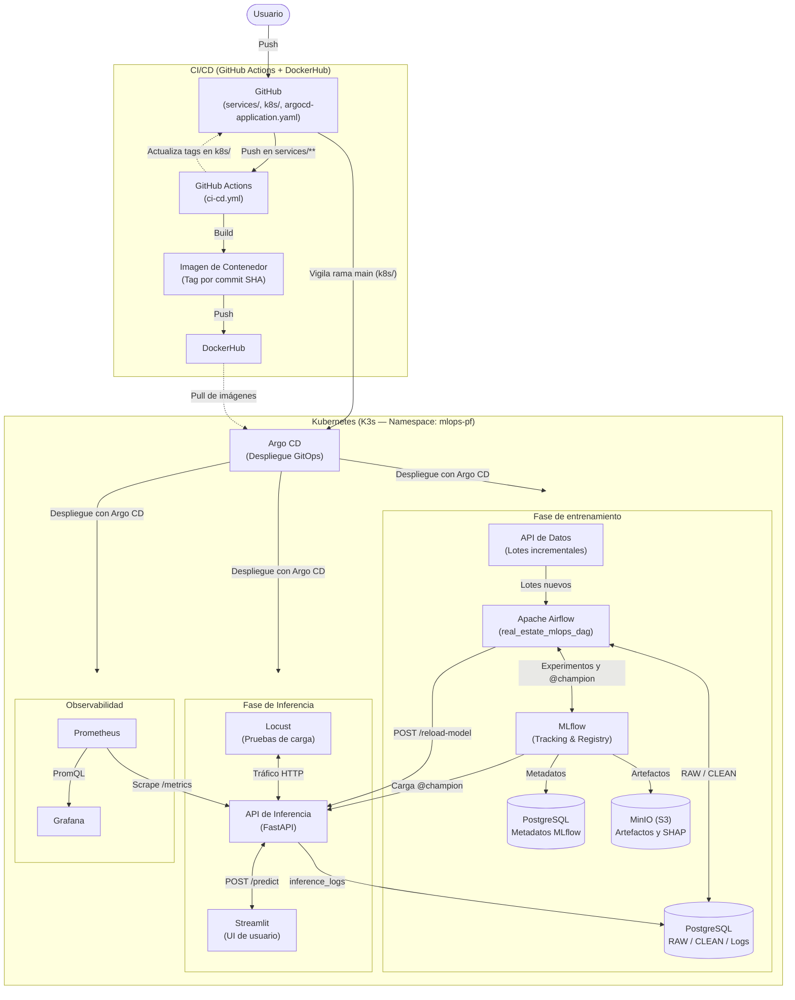

---

## 2. Estructura del Proyecto

```text
Proyecto_Final_MLOPS/
├── .github/
│   └── workflows/
│       └── ci-cd.yml                      # Pipeline CI/CD: build Docker Hub + bump GitOps en k8s/
├── Evidencias/                            # Capturas de validación del proyecto
├── k8s/
│   ├── base/                              # Namespace (mlops-pf), ConfigMaps y plantillas base
│   ├── infrastructure/                    # Servicios base y plataforma de datos/ML
│   │   ├── 04-mlflow.yaml                 # Deployment y Service de MLflow (puerto 5000)
│   │   ├── 05-airflow.yaml                # Deployment y Service de Airflow (puerto 8080)
│   │   └── ...                            # PostgreSQL, MinIO (9000/9001) y Data API (80)
│   ├── apps/                              # Microservicios de aplicación y pruebas
│   │   ├── 06-fastapi.yaml                # API de inferencia y métricas Prometheus (puerto 8000)
│   │   ├── 07-streamlit.yaml              # Interfaz web de inferencia e historial (puerto 8501)
│   │   └── 08-locust.yaml                 # Generador de pruebas de carga (puerto 8089)
│   └── observability/                     # Stack de monitoreo
│       ├── ...                            # Prometheus (puerto 9090)
│       └── ...                            # Grafana (puerto 3000) con dashboards aprovisionados
├── services/
│   ├── airflow/
│   │   ├── dags/
│   │   │   ├── real_estate_mlops_dag.py   # DAG principal MLOps (ingesta, drift, MLflow, promoción)
│   │   │   └── shap_explainer.py          # Generación de explicabilidad SHAP registrada en MLflow
│   │   ├── Dockerfile
│   │   └── requirements.txt
│   ├── fastapi/
│   │   ├── app/
│   │   │   └── main.py                    # Endpoints /health, /predict, /reload-model y /metrics
│   │   ├── Dockerfile
│   │   └── requirements.txt
│   ├── locust/                            # Definición de usuarios virtuales y tráfico hacia FastAPI
│   ├── mlflow/                            # Imagen personalizada del servidor de tracking MLflow
│   └── streamlit/                         # Aplicación web para inferencia, historial y SHAP
├── argocd-application.yaml                # Definición declarativa de la aplicación en Argo CD
├── start-ports.sh                         # Script automatizado para gestionar todos los port-forwards
├── MLOPS_Proyecto_Final_2026_2.pdf        # Enunciado / documentación oficial del proyecto final
├── .gitignore
└── README.md
```

---

## 3. Definición y Funcionamiento de Servicios

### Resumen de Servicios y Mapa de Puertos

| Servicio | Capa / Rol | Servicio K3s | Puerto Interno | Puerto Local (`port-forward`) |
| :--- | :--- | :--- | :---: | :---: |
| **Data API** | Fuente de datos por lotes | `data-api-svc` | `80` | `8002` |
| **PostgreSQL** | Base de datos (`RAW`, `CLEAN`, logs, metadatos) | `postgres-svc` | `5432` | *(interno)* |
| **MinIO** | Artifact Store compatible con S3 | `minio-svc` | `9000` / `9001` | `9001` (Consola) |
| **Apache Airflow** | Orquestación CT/CD y reglas de entrenamiento | `airflow-svc` | `8080` | `8080` |
| **MLflow** | Experiment Tracking & Model Registry | `mlflow-svc` | `5000` | `5000` |
| **FastAPI** | Inferencia productiva con *hot reload* | `fastapi-svc` | `8000` | `8000` |
| **Streamlit** | Interfaz web (predicción, historial y SHAP) | `streamlit-svc` | `8501` | `8501` |
| **Locust** | Pruebas de carga y estrés HTTP | `locust-svc` | `8089` | `8089` |
| **Prometheus** | Recolección (*scraping*) de métricas | `prometheus-svc` | `9090` | `9090` |
| **Grafana** | Dashboards en tiempo real | `grafana-svc` | `3000` | `3000` |
| **Argo CD** | Controlador GitOps (namespace `argocd`) | `argocd-server` | `443` | `8081` |

---

### 3.1. Fuente de Datos e Infraestructura Base

- **Data API (`data-api-svc:80` -> local `8002`):**
  - **Imagen:** `cristiandiaz13/mlops-puj:data-api-pf-v2`
  - **Función:** Simula la fuente externa de datos inmobiliarios entregando lotes incrementales bajo demanda a través de `GET /data?group_number=3&day=Tuesday`. Permite evaluar la evolución temporal de los datos y la aparición de *data drift*.
- **PostgreSQL (`5432`):**
  - **Función:** Motor relacional central que cumple tres responsabilidades:
    1. **Datos analíticos y auditoría:** separa explícitamente las capas `raw_data` (datos crudos inmutables) y `clean_data` (datos validados y preprocesados), mantiene el historial de lotes, registra decisiones en `training_audit_log` y almacena las predicciones en `raw_data.inference_logs`.
    2. **Backend Store de MLflow:** guarda metadatos de experimentos, ejecuciones (*runs*), parámetros, métricas y versiones de modelos.
    3. **Metadata DB de Airflow:** persiste el estado de los DAGs, tareas y corridas.
- **MinIO (`9000` API / `9001` Consola):**
  - **Función:** Almacenamiento de objetos compatible con S3 utilizado por MLflow como *Artifact Store* para guardar binarios de modelos (`sklearn`), gráficos de desempeño y artefactos de explicabilidad **SHAP**. Las credenciales (`MINIO_ROOT_USER` y `MINIO_ROOT_PASSWORD`) se gestionan vía `mlops-secrets`.

---

### 3.2. Orquestación, Entrenamiento y Registro de Modelos

- **Apache Airflow (`airflow-svc:8080`):**
  - **Imagen:** `joshin290/mlops-pf-airflow:<commit-sha>`
  - **DAG principal:** `real_estate_mlops_dag` (`schedule_interval=None`, `catchup=False`, `max_active_runs=1`).
  - **Flujo interno:** Aunque el disparo es manual bajo demanda, la decisión de entrenar y promover es **100 % automática**:
    1. **Ingesta y separación:** consume el siguiente lote desde `data-api-svc` (`DATA_API_GROUP=3`, `DATA_API_DAY=Tuesday`) y persiste `raw_data` y `clean_data` con trazabilidad por lote.
    2. **Validación y reglas de entrenamiento:** verifica esquema, nulos, duplicados, *outliers*, nuevas categorías y *drift* (`scipy.stats.ks_2samp`), bifurcando mediante `BranchPythonOperator`.
    3. **Entrenamiento y registro:** entrena el candidato con `TargetEncoder(smooth="auto", target_type="continuous")` y registra parámetros, métricas (MAE, RMSE, $R^2$) y artefactos en MLflow.
    4. **Comparación y promoción:** contrasta el candidato contra `models:/<MODEL_NAME>@champion`. Si mejora, mueve el alias `@champion` y notifica a FastAPI vía `POST /reload-model`; en caso contrario, asigna `challenger_rejected`.
    5. **Explicabilidad (`shap_explainer.py`):** genera análisis SHAP del modelo ganador y lo registra en MLflow.
- **MLflow (`mlflow-svc:5000`):**
  - **Imagen:** `joshin290/mlops-pf-mlflow:<commit-sha>`
  - **Función:** Servidor de seguimiento (*Tracking Server*) y registro de modelos (*Model Registry*) bajo el experimento `real_estate_continuous_training`. Centraliza metadatos en PostgreSQL, artefactos en MinIO y versionado mediante aliases (`@champion` y `challenger_rejected`), desacoplando entrenamiento e inferencia.

---

### 3.3. Inferencia y Capa de Usuario

- **FastAPI (`fastapi-svc:8000`):**
  - **Imagen:** `joshin290/mlops-pf-fastapi:<commit-sha>`
  - **Función:** Microservicio de inferencia productiva. Al iniciar consulta `MlflowClient.get_model_version_by_alias(MODEL_NAME, "champion")` y carga `models:/<MODEL_NAME>@champion` en memoria.
  - **Endpoints expuestos:**
    - `GET /health`: retorna estado de salud y versión activa (`{"status": "healthy", "model_version": "..."}`).
    - `POST /predict`: estima el precio inmobiliario, guarda la solicitud en `raw_data.inference_logs` y actualiza contadores de Prometheus.
    - `POST /reload-model`: protegido por `ADMIN_RELOAD_TOKEN` (header `X-Admin-Token`), recarga `@champion` en memoria sin reiniciar el pod ni redesplegar la imagen.
    - `GET /metrics`: expone métricas Prometheus (`inference_requests_total`, `loaded_model_version`, latencias y errores).
- **Streamlit (`streamlit-svc:8501`):**
  - **Imagen:** `joshin290/mlops-pf-streamlit:<commit-sha>`
  - **Función:** Portal interactivo para usuarios finales y auditoría. Integra pestañas para predicciones en vivo contra FastAPI, consulta del historial de lotes/decisiones/inferencias en PostgreSQL y visualización de explicabilidad **SHAP**.

---

### 3.4. Pruebas de Carga, Observabilidad y GitOps

- **Locust (`locust-svc:8089`):**
  - **Imagen:** `joshin290/mlops-pf-locust:<commit-sha>`
  - **Función:** Simula usuarios concurrentes enviando tráfico HTTP al DNS interno `http://fastapi-svc:8000` para evaluar estabilidad, latencia, tasa de errores y RPS bajo carga sostenida.
- **Prometheus (`9090`) y Grafana (`3000`):**
  - **Imágenes:** `prom/prometheus:v2.54.1` y `grafana/grafana:11.2.0`.
  - **Función:** Prometheus realiza *scraping* periódico sobre `/metrics` de `fastapi-svc:8000`. Grafana se conecta a Prometheus y presenta el dashboard **`MLOps FastAPI & Locust Observability`** con paneles de RPS, Latencia P95, versión activa `@champion`, tasa de errores y consumo de CPU/RAM.
- **GitHub Actions (`.github/workflows/ci-cd.yml`) y Argo CD (`argocd-application.yaml`):**
  - **GitHub Actions:** se dispara en `push` a `main` sobre `services/**` o `.github/workflows/ci-cd.yml` (y vía `workflow_dispatch`), compila en matriz los 5 microservicios (`mlflow`, `airflow`, `fastapi`, `streamlit`, `locust`), publica tags `:<github.sha>` y `:latest` en Docker Hub y actualiza los manifiestos de `k8s/` mediante commit automático `[skip ci]`.
  - **Argo CD:** vigila `path: k8s` en la rama `main` de GitHub con `automated` (`prune: true`, `selfHeal: true`), sincronizando el clúster K3s en `mlops-pf` y revirtiendo desviaciones manuales.

---

## 4. Diseño y Operación del DAG de Airflow (`real_estate_mlops_dag`)

El flujo de entrenamiento continuo está implementado en `services/airflow/dags/real_estate_mlops_dag.py` con `schedule_interval=None` (ejecución controlada bajo demanda), `catchup=False` y `max_active_runs=1`. Su estructura toma como base las **19 tareas** de referencia del diseño MLOps y añade **1 etapa adicional de explicabilidad (`explain_champion_model`)** ejecutada exclusivamente sobre el modelo ganador (`@champion`), completando un grafo de **20 tareas** con dos bifurcaciones condicionales (`BranchPythonOperator`).

### Diagrama del Grafo de Ejecución (Airflow Graph)

```mermaid
flowchart LR
    start["<b>start</b><br/>EmptyOperator"]
    fetch["<b>fetch_batch_from_api</b><br/>PythonOperator"]
    raw["<b>store_raw_batch</b><br/>PythonOperator"]
    schema["<b>validate_schema</b><br/>PythonOperator"]
    quality["<b>validate_data_quality</b><br/>PythonOperator"]
    newcat["<b>detect_new_categories</b><br/>PythonOperator"]
    drift["<b>detect_data_drift</b><br/>PythonOperator"]
    prep["<b>preprocess_data</b><br/>PythonOperator"]
    dec_train["<b>decide_training</b><br/>BranchPythonOperator"]

    skip["<b>skip_training</b><br/>PythonOperator"]

    train["<b>train_candidate_model</b><br/>PythonOperator"]
    eval["<b>evaluate_candidate_model</b><br/>PythonOperator"]
    reg["<b>register_candidate_in_mlflow</b><br/>PythonOperator"]
    comp["<b>compare_with_production</b><br/>PythonOperator"]
    dec_prom["<b>decide_promotion</b><br/>BranchPythonOperator"]

    reject["<b>reject_model</b><br/>PythonOperator"]
    promote["<b>promote_model</b><br/>PythonOperator"]
    shap["<b>explain_champion_model</b><br/>PythonOperator (SHAP ★)"]

    notify["<b>notify_or_log_result</b><br/>PythonOperator"]
    finish["<b>end</b><br/>EmptyOperator"]

    start --> fetch --> raw --> schema --> quality --> newcat --> drift --> prep --> dec_train

    dec_train -->|"No entrenar"| skip --> notify
    dec_train -->|"Entrenar"| train --> eval --> reg --> comp --> dec_prom

    dec_prom -->|"Rechazar"| reject --> notify
    dec_prom -->|"Promover @champion"| promote --> shap --> notify

    notify --> finish

    classDef emptyOp fill:#e8f5e9,stroke:#81c784,color:#1b5e20,stroke-width:1.5px;
    classDef pythonOp fill:#fff3ee,stroke:#d7ccc8,color:#3e2723,stroke-width:1.5px;
    classDef branchOp fill:#fff8e1,stroke:#ffb74d,color:#e65100,stroke-width:2px;
    classDef shapOp fill:#e3f2fd,stroke:#1976d2,color:#0d47a1,stroke-width:2.5px;

    class start,finish emptyOp;
    class fetch,raw,schema,quality,newcat,drift,prep,skip,train,eval,reg,comp,reject,promote,notify pythonOp;
    class dec_train,dec_prom branchOp;
    class shap shapOp;
```

---

### Operación Detallada de Cada Etapa

#### Fase 1: Inicio, Ingesta y Capa `RAW`
1. **`start` (`EmptyOperator`):** Marca el inicio formal del *DAG Run* y sirve como nodo raíz limpio para la trazabilidad de cada corrida.
2. **`fetch_batch_from_api` (`PythonOperator`):** Consume el siguiente lote desde `GET http://data-api-svc/data` enviando `group_number=3` (`DATA_API_GROUP`) y `day=Tuesday` (`DATA_API_DAY`). Serializa la respuesta a JSON, calcula un hash **SHA-256** para garantizar trazabilidad e idempotencia, y guarda el archivo temporal del lote para las etapas siguientes.
3. **`store_raw_batch` (`PythonOperator`):** Verifica si el lote (vía hash/identificador) ya fue ingerido previamente y persiste los registros originales sin modificar en el esquema **`raw_data`** de PostgreSQL, preservando evidencia inmutable para auditoría.

#### Fase 2: Validación de Datos, *Drift* y Capa `CLEAN`
4. **`validate_schema` (`PythonOperator`):** Verifica que el lote contenga exactamente las columnas esperadas (`brokered_by`, `status`, `price`, `bed`, `bath`, etc.), tipos compatibles y estructura mínima antes de permitir cualquier transformación.
5. **`validate_data_quality` (`PythonOperator`):** Audita la calidad estadística y operativa del lote: conteo y proporción de valores nulos, registros duplicados, rangos numéricos válidos, *outliers* y consistencia general.
6. **`detect_new_categories` (`PythonOperator`):** Compara los valores categóricos del lote entrante frente a los registros históricos para identificar categorías inéditas y asegurar que el codificador (`TargetEncoder`) las maneje sin romper el pipeline de entrenamiento ni la inferencia.
7. **`detect_data_drift` (`PythonOperator`):** Ejecuta la prueba estadística de **Kolmogorov-Smirnov de dos muestras (`scipy.stats.ks_2samp`)** comparando la distribución de las variables numéricas del lote reciente frente a la referencia histórica acumulada, cuantificando si existe *data drift* significativo.
8. **`preprocess_data` (`PythonOperator`):** Aplica la limpieza de datos (casteo de tipos, imputación/filtrado de nulos, remoción de duplicados y estandarización) y actualiza el esquema **`clean_data`** en PostgreSQL, dejando el conjunto listo para entrenamiento.

#### Fase 3: Decisión Automática de Entrenamiento
9. **`decide_training` (`BranchPythonOperator`):** Evalúa de forma determinística las señales generadas por las etapas previas (validez del lote, no duplicidad, detección de *drift* vía `ks_2samp`, volumen acumulado o ausencia de un `@champion` inicial) y bifurca el grafo hacia una sola ruta:
   - **`skip_training`** si no se cumplen las condiciones técnicas.
   - **`train_candidate_model`** si se requiere entrenar un nuevo modelo.
10. **`skip_training` (`PythonOperator`):** Rama de omisión controlada. Registra explícitamente la razón técnica por la cual no se ejecutó entrenamiento (por ejemplo, lote duplicado, inválido o sin evidencia suficiente de cambio), evitando consumo innecesario de CPU/RAM.

#### Fase 4: Entrenamiento, Evaluación y Registro en MLflow
11. **`train_candidate_model` (`PythonOperator`):** Entrena el modelo de regresión candidato sobre el dataset actualizado en `clean_data`, aplicando `TargetEncoder(smooth="auto", target_type="continuous")` sobre variables categóricas de alta cardinalidad (`brokered_by`, `city`, `zip_code`) para evitar expansión multiclase en memoria.
12. **`evaluate_candidate_model` (`PythonOperator`):** Evalúa el modelo candidato sobre el conjunto de prueba calculando métricas cuantitativas de regresión (**MAE**, **RMSE**, **$R^2$** y **MAPE**) y generando los gráficos de diagnóstico y residuales.
13. **`register_candidate_in_mlflow` (`PythonOperator`):** Registra la corrida completa en el experimento **`real_estate_continuous_training`** de MLflow (`http://mlflow-svc:5000`), almacenando hiperparámetros, lotes utilizados y métricas en PostgreSQL, el binario serializado y gráficos en **MinIO**, y creando una nueva versión en el Model Registry (`real_estate_pricer`).

#### Fase 5: Comparación contra Producción y Promoción
14. **`compare_with_production` (`PythonOperator`):** Consulta el modelo productivo vigente (`models:/real_estate_pricer@champion`) y contrasta sus métricas (**MAE** y **RMSE**, con $R^2$ como referencia) frente al modelo candidato recién registrado.
15. **`decide_promotion` (`BranchPythonOperator`):** Bifurca el flujo según el resultado de la comparación:
    - Si el candidato supera al campeón actual (o es el primer modelo del sistema), enruta a **`promote_model`**.
    - Si no mejora el desempeño productivo, enruta a **`reject_model`**.
16. **`promote_model` (`PythonOperator`):** Reasigna automáticamente el alias **`@champion`** en el Model Registry de MLflow a la nueva versión ganadora y envía una petición autenticada `POST http://fastapi-svc:8000/reload-model` (con el header `X-Admin-Token`) para que `ThreadSafeModelManager` recargue el modelo en memoria en caliente sin reiniciar el pod.
17. **`explain_champion_model` (`PythonOperator` — Etapa adicional SHAP):** Invoca `services/airflow/dags/shap_explainer.py` sobre la nueva versión **`@champion`** para calcular valores SHAP e importancia global/local de variables, subiendo los artefactos resultantes a MLflow/MinIO (`shap_analysis`) para su consumo inmediato desde Streamlit.
18. **`reject_model` (`PythonOperator`):** Mantiene intacto al `@champion` en producción, etiqueta la versión candidata como **`challenger_rejected`** en MLflow y documenta los motivos métricos del rechazo.

#### Fase 6: Auditoría Consolidada y Cierre
19. **`notify_or_log_result` (`PythonOperator`):** Configurada con `trigger_rule=TriggerRule.NONE_FAILED_MIN_ONE_SUCCESS` para ejecutarse correctamente sin importar cuál de las tres ramas terminó (`skip_training`, `reject_model` o `promote_model -> explain_champion_model`). Consolida el estado final, métricas, decisiones y versión activa en **`training_audit_log`** de PostgreSQL, alimentando el historial visible en **Streamlit**.
20. **`end` (`EmptyOperator`):** Configurada igualmente con `trigger_rule=TriggerRule.NONE_FAILED_MIN_ONE_SUCCESS`, cierra el ciclo del DAG con un estado final limpio e interpretable.

---

### ¿Por qué se adicionó la etapa `explain_champion_model` (SHAP) solo para el modelo ganador?

El diseño de referencia contempla 19 tareas como base mínima y permite ampliar el DAG con justificación técnica. La decisión de insertar **`explain_champion_model`** inmediatamente después de **`promote_model`** (en lugar de ejecutar SHAP durante `evaluate_candidate_model`) responde a cuatro criterios de ingeniería MLOps:

1. **Eficiencia computacional y control de memoria (`OOMKilled`):** El cálculo de valores SHAP sobre modelos basados en árboles y pipelines con codificación de alta cardinalidad es intensivo en CPU y RAM. Al ejecutarlo **únicamente cuando un candidato gana y se convierte en `@champion`**, se evita desperdiciar cómputo y memoria dentro del pod de Airflow (`4Gi`) explicando modelos que posteriormente serían etiquetados como `challenger_rejected`.
2. **Coherencia estricta entre producción y explicabilidad (RF9):** Al dispararse exclusivamente tras `promote_model`, se garantiza que los artefactos `shap_analysis` almacenados en MinIO/MLflow y renderizados en la pestaña de explicabilidad de **Streamlit** correspondan **siempre a la misma versión `@champion`** que está atendiendo predicciones en FastAPI.
3. **Baja latencia en la puesta en producción (RF7):** Como `promote_model` actualiza el alias `@champion` y dispara `POST /reload-model` antes de ejecutar SHAP, la API de inferencia comienza a servir el nuevo modelo ganador de inmediato sin quedar bloqueada esperando el cómputo de explicabilidad.
4. **Resiliencia y observabilidad modular:** Separar la explicabilidad en su propia tarea permite auditar sus tiempos de ejecución y logs de forma independiente, aplicar reintentos aislados si fallara la escritura de artefactos en MinIO y mantener transparente el estado final del pipeline sin ocultar errores críticos.

### Mecanismos de Resistencia a Fallos del DAG

- **Reintentos y manejo de errores:** Las tareas incorporan políticas de reintento (`retries` y `retry_delay`) y manejo explícito de códigos HTTP/timeouts en las llamadas a `data-api-svc`, MLflow y FastAPI, evitando fallos falsos por latencia de red pero fallando explícitamente ante errores críticos (nunca enmascarándolos como exitosos).
- **Control de concurrencia y convergencia de ramas:** `max_active_runs=1` previene condiciones de carrera sobre `raw_data`/`clean_data`, mientras que `TriggerRule.NONE_FAILED_MIN_ONE_SUCCESS` en `notify_or_log_result` y `end` garantiza que la auditoría se ejecute solo cuando la rama activa culmina sin fallos.

---

## 5. Modelo de Datos y Estructura de la Base de Datos (PostgreSQL)

La persistencia relacional de la plataforma se centraliza en **PostgreSQL** (`postgres-svc:5432` dentro del namespace `mlops-pf`), respaldado por un volumen persistente (**PVC**) que garantiza la conservación de los datos ante reinicios de pods o sincronizaciones de Argo CD.

La base de datos separa estrictamente los **esquemas analíticos y de auditoría del negocio** (`raw_data` y `clean_data`) de los **almacenes internos de metadatos** de la plataforma (**MLflow** y **Apache Airflow**), cumpliendo con el aislamiento de capas exigido en **RF2** y la trazabilidad end-to-end de **RF1**, **RF4**, **RF6** y **RF8**.

### Arquitectura de Esquemas y Flujo de Lectura/Escritura

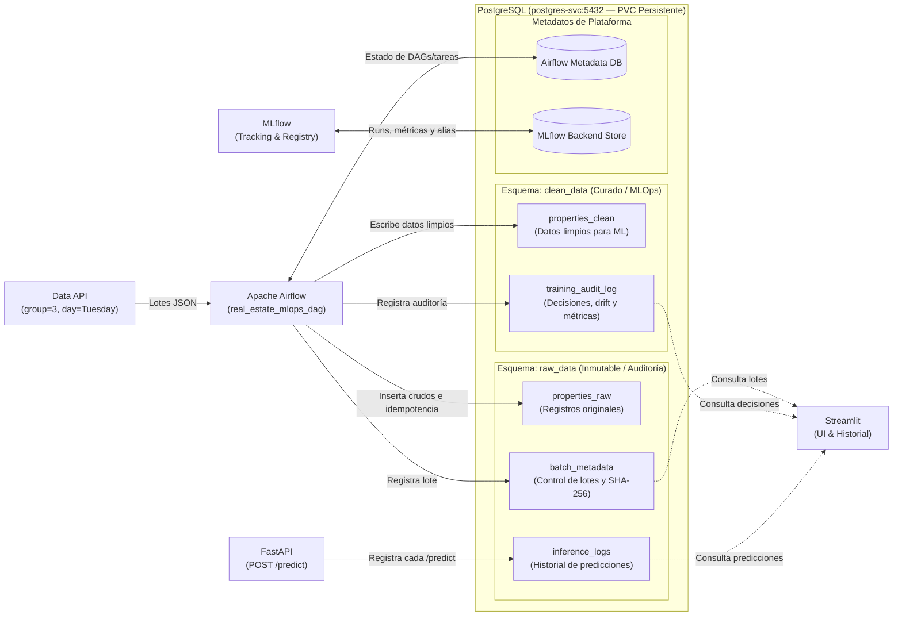

---

### Esquemas y Tablas de Negocio y Auditoría

#### 1. Esquema `raw_data` (Capa Cruda e Inmutable)
Conserva la evidencia exacta de la información recibida y servida en producción sin alteraciones destructivas:

| Tabla | Servicio Escritor | Servicio Lector | Propósito y Contenido |
| :--- | :--- | :--- | :--- |
| **`raw_data.properties_raw`** | Airflow (`store_raw_batch`) | Airflow (`validate_*`, `preprocess_data`) | Almacena los registros inmobiliarios originales tal como los entrega `data-api-svc`, preservando la fuente de verdad histórica para auditoría y reprocesamiento (RF2). |
| **`raw_data.batch_metadata`** | Airflow (`store_raw_batch`) | Airflow (`fetch_batch_from_api`, `decide_training`), Streamlit | Registra los metadatos de cada lote ingerido (identificador de lote, hash **SHA-256** del payload, fecha de ingesta y conteo de filas) para garantizar idempotencia y evitar reprocesamientos duplicados (RF1). |
| **`raw_data.inference_logs`** | FastAPI (`POST /predict`) | Streamlit, Auditoría | Persiste cada solicitud de inferencia atendida en producción: atributos de entrada del inmueble, precio estimado, marca temporal (*timestamp*) y versión exacta del modelo `@champion` que generó la predicción (RF8). |

#### 2. Esquema `clean_data` (Capa Curada y Auditoría de Entrenamiento)
Contiene los datos transformados listos para modelado y el historial completo de decisiones del pipeline:

| Tabla | Servicio Escritor | Servicio Lector | Propósito y Contenido |
| :--- | :--- | :--- | :--- |
| **`clean_data.properties_clean`** | Airflow (`preprocess_data`) | Airflow (`detect_data_drift`, `train_candidate_model`, `evaluate_candidate_model`, `explain_champion_model`) | Almacena los registros inmobiliarios depurados tras validar el esquema (`EXPECTED_COLS`), corregir tipos de datos, tratar valores nulos, eliminar duplicados y controlar *outliers* (RF2, RF3). |
| **`clean_data.training_audit_log`** | Airflow (`notify_or_log_result`) | Streamlit | Consolida la trazabilidad de cada corrida del DAG: resultado de validación y *drift* (`ks_2samp`), decisión de entrenar u omitir (`skip_training`), métricas obtenidas (MAE, RMSE, $R^2$), veredicto de promoción (`@champion` vs. `challenger_rejected`) y justificación técnica (RF4, RF6, RF9). |

#### 3. Almacenes Internos de Metadatos de Plataforma
De forma aislada a los esquemas analíticos del negocio, PostgreSQL soporta el estado operativo de las herramientas MLOps:
- **MLflow Backend Store:** guarda experimentos (`real_estate_continuous_training`), ejecuciones (*runs*), hiperparámetros, series de métricas, versiones del registro (`real_estate_pricer`) y punteros de alias (`@champion`, `challenger_rejected`), vinculando cada corrida con sus artefactos almacenados en **MinIO**.
- **Apache Airflow Metadata DB:** gestiona la programación, estados de ejecución, reintentos, XComs e historial de tareas del DAG `real_estate_mlops_dag`.

---

### Diccionario de Datos Inmobiliarios (`EXPECTED_COLS`)

La tarea `validate_schema` verifica que cada lote entrante cumpla con las **12 columnas críticas** definidas en `EXPECTED_COLS` antes de habilitar su limpieza y almacenamiento en `clean_data.properties_clean`:

| Variable | Tipo / Naturaleza | Rol en el Modelo | Descripción y Tratamiento en el Pipeline |
| :--- | :--- | :--- | :--- |
| **`price`** | Numérica continua | **Variable objetivo (*Target*)** | Precio de venta del inmueble (USD). Al presentar valores enteros sin centavos, se fuerza `target_type="continuous"` en `TargetEncoder` para evitar clasificación multiclase y `OOMKilled`. |
| **`brokered_by`** | Categórica (alta cardinalidad) | Feature | Identificador de la agencia o corredor inmobiliario. Codificada con `TargetEncoder(smooth="auto", target_type="continuous")`. |
| **`status`** | Categórica | Feature | Estado comercial de la publicación del inmueble (ej. en venta, listo para construir, vendido). |
| **`bed`** | Numérica discreta | Feature | Cantidad de habitaciones de la propiedad. Auditada por nulos, rangos y *drift* (`ks_2samp`). |
| **`bath`** | Numérica discreta | Feature | Cantidad de baños de la propiedad. Auditada por nulos, rangos y *drift*. |
| **`acre_lot`** | Numérica continua | Feature | Extensión total del lote o terreno medida en acres. Sujeta a validación de rangos y *outliers*. |
| **`street`** | Categórica / Identificador | Feature / Metadato | Código identificador de la calle o dirección del inmueble. |
| **`city`** | Categórica (alta cardinalidad) | Feature | Ciudad donde se ubica el inmueble. Monitoreada en `detect_new_categories` y codificada con `TargetEncoder`. |
| **`state`** | Categórica | Feature | Estado o territorio geográfico de ubicación de la propiedad. |
| **`zip_code`** | Categórica (alta cardinalidad) | Feature | Código postal de la propiedad. Monitoreada en `detect_new_categories` y codificada con `TargetEncoder`. |
| **`house_size`** | Numérica continua | Feature | Área construida de la vivienda (en pies cuadrados). Evaluada por calidad y *data drift*. |
| **`prev_sold_date`** | Fecha / Texto | Feature / Temporal | Fecha de la última venta registrada previamente para el inmueble (puede contener valores nulos si es propiedad nueva o sin historial). |

---

### Verificación Rápida de la Base de Datos en K3s

Para inspeccionar los esquemas, tablas y conteo de registros directamente desde el nodo `NBAM20`:

```bash
PG_POD=$(kubectl get pods -n mlops-pf -o name | grep -i postgres | head -n 1)

# Listar tablas dentro de los esquemas raw_data y clean_data
kubectl exec -n mlops-pf "$PG_POD" -- sh -c \
  'psql -U "$POSTGRES_USER" -d "$POSTGRES_DB" -c "\dt raw_data.*" -c "\dt clean_data.*"'

# Consultar conteo de registros por tabla principal
kubectl exec -n mlops-pf "$PG_POD" -- sh -c 'psql -U "$POSTGRES_USER" -d "$POSTGRES_DB" -c "
SELECT '\''raw_data.batch_metadata'\''      AS tabla, COUNT(*) AS filas FROM raw_data.batch_metadata
UNION ALL
SELECT '\''raw_data.properties_raw'\'',      COUNT(*) FROM raw_data.properties_raw
UNION ALL
SELECT '\''clean_data.properties_clean'\'',  COUNT(*) FROM clean_data.properties_clean
UNION ALL
SELECT '\''clean_data.training_audit_log'\'',COUNT(*) FROM clean_data.training_audit_log
UNION ALL
SELECT '\''raw_data.inference_logs'\'',      COUNT(*) FROM raw_data.inference_logs;
"'
```

---

## Catálogo de Imágenes Docker y Estrategia de Versionado

La plataforma combina **5 imágenes personalizadas** construidas automáticamente desde este repositorio y publicadas en **Docker Hub** (`joshin290`), junto con **imágenes oficiales y de terceros** para la fuente de datos, persistencia, observabilidad y control GitOps.

---

### 1. Imágenes Personalizadas (Docker Hub — `joshin290`)

Cada microservicio propio cuenta con su `Dockerfile` y `requirements.txt` con dependencias fijadas bajo `services/`, y se construye en paralelo mediante la matriz `build-and-push` de `.github/workflows/ci-cd.yml`:

| Servicio | Repositorio en Docker Hub | Dockerfile | Manifiesto K8s | Propósito y Dependencias Clave |
| :--- | :--- | :--- | :--- | :--- |
| **MLflow** | `joshin290/mlops-pf-mlflow:<commit-sha>` | `services/mlflow/Dockerfile` | `k8s/infrastructure/04-mlflow.yaml` | Servidor de Tracking y Model Registry (`mlflow==2.16.2`, conectores `psycopg2`/S3 para PostgreSQL y MinIO). |
| **Apache Airflow** | `joshin290/mlops-pf-airflow:<commit-sha>` | `services/airflow/Dockerfile` | `k8s/infrastructure/05-airflow.yaml` | Orquestación de `real_estate_mlops_dag.py` y `shap_explainer.py` (`scikit-learn`, `scipy`, `shap`, `mlflow`, `requests`). |
| **FastAPI** | `joshin290/mlops-pf-fastapi:<commit-sha>` | `services/fastapi/Dockerfile` | `k8s/apps/06-fastapi.yaml` | API de inferencia productiva (`fastapi`, `uvicorn`, `mlflow`, `prometheus-client`, `ThreadSafeModelManager`). |
| **Streamlit** | `joshin290/mlops-pf-streamlit:<commit-sha>` | `services/streamlit/Dockerfile` | `k8s/apps/07-streamlit.yaml` | Interfaz web multipestaña para predicción en vivo, auditoría en PostgreSQL y gráficos SHAP (`streamlit`, `pandas`, `requests`). |
| **Locust** | `joshin290/mlops-pf-locust:<commit-sha>` | `services/locust/Dockerfile` | `k8s/apps/08-locust.yaml` | Simulador de carga concurrente con usuarios virtuales apuntando a `http://fastapi-svc:8000` (`locust`). |

---

### 2. Imágenes Externas, Oficiales y Auxiliares (Datos, Infraestructura, Observabilidad y GitOps)

Los componentes de soporte utilizan imágenes oficiales, endurecidas y auxiliares fijadas en sus respectivos manifiestos:

| Servicio / Rol | Imagen Exacta | Manifiesto K8s | Namespace | Función en la Plataforma |
| :--- | :--- | :--- | :---: | :--- |
| **PostgreSQL** | `postgres:15-alpine` | `k8s/infrastructure/01-postgres.yaml` | `mlops-pf` | Motor relacional ligero para `raw_data`, `clean_data` y metadatos de Airflow/MLflow. |
| **MinIO (Servidor S3)** | `cgr.dev/chainguard/minio:latest` | `k8s/infrastructure/02-minio.yaml` | `mlops-pf` | Almacenamiento de objetos S3 (imagen endurecida de Chainguard) para artefactos y SHAP. |
| **MinIO (`initContainer`)** | `busybox:1.36` | `k8s/infrastructure/02-minio.yaml` | `mlops-pf` | Contenedor de inicialización (`fix-minio-permissions`) para ajustar permisos sobre el PVC de MinIO. |
| **MinIO (Init Buckets)** | `joshin290/mlops-pf-mlflow:latest` | `k8s/infrastructure/02-minio.yaml` | `mlops-pf` | Tarea auxiliar de inicialización para crear/verificar el bucket S3 de artefactos de MLflow. |
| **Data API** | `cristiandiaz13/mlops-puj:data-api-pf-v2` | `k8s/infrastructure/03-data-api.yaml` | `mlops-pf` | Fuente externa de lotes inmobiliarios (`GET /data?group_number=3&day=Tuesday`). |
| **Prometheus** | `prom/prometheus:v2.54.1` | `k8s/observability/09-prometheus-grafana.yaml` | `mlops-pf` | Recolección (*scraping*) de `/metrics` en FastAPI y almacenamiento de series de tiempo. |
| **Grafana** | `grafana/grafana:11.2.0` | `k8s/observability/09-prometheus-grafana.yaml` | `mlops-pf` | Visualización del dashboard `MLOps FastAPI & Locust Observability`. |
| **Argo CD** | `quay.io/argoproj/argocd` *(manifiesto `stable`)* | Instalado en clúster (`argocd-application.yaml`) | `argocd` | Controlador GitOps que sincroniza `k8s/` contra el clúster K3s. |

---

### 3. Estrategia de Construcción, Etiquetado Inmutable y Sincronización

1. **Doble etiquetado en Docker Hub (`:<github.sha>` y `:latest`):**
   - Cada ejecución exitosa de `.github/workflows/ci-cd.yml` autentica contra Docker Hub mediante los secretos `DOCKERHUB_USERNAME` y `DOCKERHUB_TOKEN`, publicando cada imagen con dos etiquetas: el **SHA completo del commit** y `:latest`.
2. **Despliegue inmutable por SHA en `k8s/`:**
   - El job `update-k8s-manifests` reemplaza los tags en `k8s/infrastructure/` y `k8s/apps/` usando siempre la etiqueta inmutable `:<github.sha>` (nunca `:latest`) y publica un commit automático con `[skip ci]`.
   - **Por qué es clave en GitOps:** si se usara `:latest`, Argo CD no detectaría cambios en los manifiestos YAML al actualizar código; usar el SHA garantiza trazabilidad exacta entre commit de GitHub, imagen en Docker Hub y pod en ejecución, además de permitir *rollbacks* inmediatos con `git revert`.
3. **Compilaciones limpias y gestión de espacio en `NBAM20`:**
   - Como cada build genera una etiqueta SHA distinta, el runtime `containerd` de K3s acumula capas anteriores en `/var` (partición de 15 GB en `NBAM20`). Para prevenir alertas de `DiskPressure`, se mantiene la poda periódica con `crictl rmi --prune` sin afectar los pods activos.

---

### 4. Comandos de Verificación y Mantenimiento de Imágenes en K3s

```bash
# Listar la imagen exacta y tag desplegado en cada Deployment de mlops-pf
kubectl get deploy -n mlops-pf -o jsonpath='{range .items[*]}{.metadata.name}{"\t"}{.spec.template.spec.containers[0].image}{"\n"}{end}'

# Ver las imágenes de PostgreSQL y MinIO definidas en los manifiestos locales
grep -rn "image:" k8s/

# Inspeccionar imágenes almacenadas en el runtime containerd de K3s (NBAM20)
sudo /usr/local/bin/k3s crictl images

# Podar imágenes y capas sin uso para liberar espacio en /var
sudo /usr/local/bin/k3s crictl rmi --prune
df -h /var
```
---

## 6. Cumplimiento de Requerimientos Funcionales (RF1-RF10)

### Matriz Resumen de Trazabilidad

| RF | Requerimiento | Mecanismo Técnico Implementado | Servicios y Archivos Clave |
| :--- | :--- | :--- | :--- |
| **RF1** | Ingesta incremental por lotes | Consumo incremental desde Data API (`group_number=3`, `day=Tuesday`) con control de lotes ya ingeridos en PostgreSQL y `max_active_runs=1`. | Airflow (`real_estate_mlops_dag.py`), Data API, PostgreSQL |
| **RF2** | Separación `RAW` / `CLEAN` | Esquemas relacionales independientes (`raw_data` inmutable y `clean_data` depurado) dentro de PostgreSQL. | PostgreSQL, Airflow |
| **RF3** | Calidad de datos y *data drift* | Auditoría de esquema, nulos, duplicados, *outliers*, nuevas categorías y prueba estadística Kolmogorov-Smirnov (`ks_2samp`). | Airflow (`real_estate_mlops_dag.py`) |
| **RF4** | Decisión automática de entrenamiento | Bifurcación condicional con `BranchPythonOperator` basada en reglas técnicas y registro en `training_audit_log`. | Airflow, PostgreSQL |
| **RF5** | Trazabilidad en MLflow y MinIO | Tracking completo en `real_estate_continuous_training` (parámetros, lotes, métricas MAE/RMSE/$R^2$) y artefactos/SHAP en S3. | MLflow, PostgreSQL, MinIO, `shap_explainer.py` |
| **RF6** | Comparación y promoción `@champion` | Contraste automático de MAE y RMSE contra la versión productiva; asignación de alias `@champion` o `challenger_rejected`. | Airflow, MLflow Model Registry |
| **RF7** | Actualización sin redespliegue | Recarga en memoria mediante `POST /reload-model` autenticado con `X-Admin-Token`, sin reiniciar pods ni ejecutar CI/CD. | FastAPI (`main.py`), Airflow, MLflow |
| **RF8** | Persistencia de inferencias | Inserción automática de cada solicitud `/predict` con entradas, predicción, fecha y versión en `raw_data.inference_logs`. | FastAPI (`main.py`), PostgreSQL |
| **RF9** | Interfaz de usuario y explicabilidad | Aplicación multipestaña para inferencia en vivo, historial de lotes/predicciones y visualización de explicabilidad **SHAP**. | Streamlit (`app.py`), FastAPI, PostgreSQL |
| **RF10** | Pruebas de carga y observabilidad | Simulación de carga con Locust hacia `fastapi-svc:8000`, *scraping* en `/metrics` por Prometheus y dashboard en Grafana. | Locust, FastAPI, Prometheus, Grafana |

---

### Detalle Técnico por Requerimiento

#### RF1 — Ingesta incremental por lotes sin reprocesamiento
- **Qué solicita:** Incorporar periódicamente nuevos lotes de datos inmobiliarios desde una API externa evitando duplicados, reprocesamientos innecesarios y pérdida de trazabilidad por lote.
- **Solución implementada:** En `services/airflow/dags/real_estate_mlops_dag.py`, las tareas de ingesta con `PythonOperator` consultan `data-api-svc` enviando `group_number` (`DATA_API_GROUP=3`) y `day` (`DATA_API_DAY=Tuesday`). Antes de persistir, el DAG verifica en PostgreSQL los lotes procesados previamente para garantizar idempotencia e incorporar solo registros nuevos con su identificador de lote. `max_active_runs=1` y `catchup=False` evitan condiciones de carrera.
- **Cómo verificarlo:** Disparando `real_estate_mlops_dag` en Airflow (`http://localhost:8080`), inspeccionando los logs de `data-api-svc` y consultando las tablas de ingesta en PostgreSQL.

#### RF2 — Separación estricta de capas `RAW` y `CLEAN`
- **Qué solicita:** Preservar los datos originales exactamente como llegan de la fuente externa, separándolos de los datos limpios y transformados usados para entrenamiento.
- **Solución implementada:** PostgreSQL segrega dos esquemas dedicados:
  1. **`raw_data`:** almacena los registros crudos e inmutables recibidos desde `Data API`, conservando la evidencia exacta de cada lote.
  2. **`clean_data`:** almacena los datos transformados por Airflow tras limpieza de tipos, tratamiento de nulos, eliminación de duplicados y estandarización de variables.
- **Cómo verificarlo:** Consultando los esquemas `raw_data` y `clean_data` directamente en PostgreSQL dentro de `mlops-pf`.

#### RF3 — Validación de calidad de datos y detección de *data drift*
- **Qué solicita:** Auditar automáticamente la integridad estructural y estadística de cada lote entrante y detectar cambios de distribución (*data drift*) o nuevas categorías antes de entrenar.
- **Solución implementada:** El DAG ejecuta una etapa de validación que audita:
  - **Integridad estructural:** esquema esperado, columnas obligatorias y tipos de datos.
  - **Calidad de registros:** porcentaje de nulos, duplicados y control de *outliers*.
  - **Nuevas categorías:** detección de valores categóricos no vistos en lotes previos.
  - **Detección estadística de *drift*:** prueba Kolmogorov-Smirnov de dos muestras (`scipy.stats.ks_2samp`) comparando la distribución del lote reciente contra el histórico acumulado.
- **Cómo verificarlo:** Revisando los logs de las tareas de validación y *drift* en Airflow y los registros en `training_audit_log`.

#### RF4 — Decisión automática de entrenamiento (Bifurcación del Pipeline)
- **Qué solicita:** Automatizar la decisión de entrenar o no un nuevo modelo mediante criterios técnicos objetivos, evitando cómputo innecesario.
- **Solución implementada:** Un `BranchPythonOperator` evalúa las salidas de validación y *drift* (nuevos lotes válidos, *drift* significativo vía `ks_2samp` o ausencia de `@champion` inicial):
  - Si se cumplen los criterios, enruta hacia la rama de entrenamiento, registro en MLflow y evaluación.
  - Si no se justifica reentrenar, toma la rama de omisión (*skip*) finalizando limpiamente.
  - Cada decisión queda auditada en **`training_audit_log`** en PostgreSQL.
- **Cómo verificarlo:** Inspeccionando la vista *Graph* del DAG en Airflow y consultando `training_audit_log`.

#### RF5 — Trazabilidad completa y reproducibilidad de experimentos en MLflow
- **Qué solicita:** Registrar de forma centralizada y auditable cada entrenamiento con sus datos, parámetros, métricas y artefactos.
- **Solución implementada:** Cada ejecución se registra bajo `real_estate_continuous_training` en MLflow (`http://mlflow-svc:5000`), respaldado por PostgreSQL y MinIO:
  - Parámetros de preprocesamiento, particiones, lotes utilizados e hiperparámetros.
  - Métricas de regresión: **MAE**, **RMSE** y **$R^2$**.
  - Artefactos en MinIO: binario del modelo, gráficas de evaluación y explicabilidad generada con `services/airflow/dags/shap_explainer.py`.
- **Cómo verificarlo:** En MLflow (`http://localhost:5000`) y en los buckets de MinIO Console (`http://localhost:9001`).

#### RF6 — Comparación automática contra producción y promoción condicionada (`@champion`)
- **Qué solicita:** Evaluar cada modelo candidato frente al productivo actual y promoverlo únicamente si mejora el desempeño.
- **Solución implementada:** Tras registrar el candidato en MLflow Model Registry, el DAG compara **MAE** y **RMSE** (con $R^2$ como referencia) contra la versión etiquetada como **`@champion`**:
  - Si el candidato supera al campeón (o es el primer modelo), Airflow reasigna el alias **`@champion`** a la nueva versión.
  - Si no mejora, mantiene al campeón vigente y etiqueta el candidato como **`challenger_rejected`**.
- **Cómo verificarlo:** En la pestaña **Models** de MLflow (`http://localhost:5000`) y en `training_audit_log`.

#### RF7 — Actualización del modelo en producción sin redespliegue (*Hot Reload*)
- **Qué solicita:** Poner en producción un modelo aprobado sin reconstruir imágenes Docker, sin ejecutar CI/CD ni reiniciar el pod de FastAPI.
- **Solución implementada:** `services/fastapi/app/main.py` descarga `models:/<MODEL_NAME>@champion` al iniciar y expone **`POST /reload-model`** protegido mediante el header **`X-Admin-Token`** (`ADMIN_RELOAD_TOKEN`). Al promover un nuevo `@champion`, Airflow invoca `http://fastapi-svc:8000/reload-model`, actualizando el modelo en memoria sin tiempo de inactividad y reflejando de inmediato la nueva versión en `GET /health` y en la métrica `loaded_model_version`.
- **Cómo verificarlo:** Consultando `GET http://localhost:8000/health` antes y después de una promoción y verificando que el pod de FastAPI no se reinició (`kubectl get pods -n mlops-pf`).

#### RF8 — Registro persistente y auditoría de inferencias
- **Qué solicita:** Almacenar el historial completo de cada predicción atendida por la API para auditoría y monitoreo.
- **Solución implementada:** Cada invocación exitosa a **`POST /predict`** inserta una fila en **`raw_data.inference_logs`** (PostgreSQL) con los atributos de entrada del inmueble, el precio predicho, el *timestamp* y la versión exacta del modelo `@champion`.
- **Cómo verificarlo:** Ejecutando una predicción desde Streamlit o Swagger (`http://localhost:8000/docs`) y consultando `raw_data.inference_logs`.

#### RF9 — Interfaz web para inferencia, historial operativo y explicabilidad SHAP
- **Qué solicita:** Proveer una interfaz web accesible para consumir predicciones, revisar el historial e interpretar variables del modelo.
- **Solución implementada:** `services/streamlit/app.py` (`http://localhost:8501`) organiza tres vistas:
  1. **Predicción en vivo:** formulario conectado vía `POST /predict` a `http://fastapi-svc:8000`.
  2. **Historial y trazabilidad:** consulta de lotes ingeridos, `training_audit_log` y `raw_data.inference_logs`.
  3. **Explicabilidad SHAP:** visualización de importancia y contribución de variables generada por `shap_explainer.py`.
- **Cómo verificarlo:** Accediendo a `http://localhost:8501`, realizando una predicción y recorriendo las pestañas de historial y SHAP.

#### RF10 — Pruebas de carga y observabilidad integral en tiempo real
- **Qué solicita:** Evaluar la API bajo tráfico concurrente y monitorear métricas técnicas y de modelo en tableros en vivo.
- **Solución implementada:**
  - **Locust (`http://localhost:8089`):** envía tráfico concurrente al DNS interno `http://fastapi-svc:8000`.
  - **FastAPI (`GET /metrics`):** expone `inference_requests_total`, `loaded_model_version`, latencias y tasa de error.
  - **Prometheus (`http://localhost:9090`):** recolecta `/metrics` (target `fastapi-svc:8000` en estado `UP`).
  - **Grafana (`http://localhost:3000`):** dashboard **`MLOps FastAPI & Locust Observability`** con paneles de RPS, Latencia P95, versión `@champion`, tasa de errores y consumo de CPU/RAM.
- **Cómo verificarlo:** Lanzando carga en Locust hacia `http://fastapi-svc:8000`, confirmando el target `UP` en Prometheus y observando Grafana en ventana `Last 15 minutes` (`5s`).

---

## 7. Ciclo de Vida: Despliegue de Código vs. Despliegue de Modelos

| Escenario | Quién actúa | ¿Pasa por GitHub Actions / Argo CD? |
| :--- | :--- | :--- |
| **Cambio de código en microservicios** (`services/**`) | GitHub Actions construye imágenes y actualiza `k8s/` -> Argo CD sincroniza en K3s. | **Sí** (CI/CD + GitOps completo). |
| **Cambio directo en manifiestos** (`k8s/**`) | Argo CD detecta el commit en `main` y aplica el estado en `mlops-pf`. | **Solo Argo CD** (no dispara build de imágenes). |
| **Entrenamiento y promoción de un nuevo modelo** | Airflow ejecuta `real_estate_mlops_dag` -> MLflow actualiza `@champion` -> FastAPI ejecuta `POST /reload-model`. | **No** (recarga en caliente sin redespliegue). |

---

## 8. Procedimiento de Creación y Configuración del Proyecto

El desarrollo de la plataforma siguió una estrategia incremental: primero se diseñaron, dimensionaron y validaron los servicios en el entorno local de K3s (`NBAM20`), luego se incorporó la explicabilidad del modelo productivo y finalmente se automatizó el ciclo completo de integración y despliegue continuo (**CI/CD + GitOps**).

### 8.1. Diseño de Arquitectura y Dimensionamiento de Recursos por Servicio
Antes de desplegar los microservicios en Kubernetes, fue necesario definir los recursos de cómputo (**CPU y memoria RAM** mediante `requests` y `limits`) y el **espacio de almacenamiento persistente (PVCs)** que requería cada componente, considerando las restricciones físicas del nodo `NBAM20` (particularmente la partición `/var` de 15 GB y la memoria compartida del clúster):

- **Almacenamiento persistente (PVCs):** se reservaron volúmenes dedicados para **PostgreSQL** (esquemas `raw_data`, `clean_data`, `training_audit_log`, `inference_logs` y metadatos de Airflow/MLflow) y para **MinIO** (almacenamiento S3 de modelos serializados, gráficas y artefactos SHAP), incluyendo el `initContainer` `fix-minio-permissions` para garantizar permisos de escritura al iniciar.
- **Asignación de memoria y CPU por carga de trabajo:**
  - **Airflow:** se le asignó el mayor techo de memoria (`4Gi`) por ejecutar preprocesamiento, validación estadística (`ks_2samp`) y entrenamiento de modelos dentro del pod, fijando explícitamente `AIRFLOW__WEBSERVER__WORKERS=1` para evitar que Gunicorn consumiera ~1 GiB base adicional con sus 4 workers por defecto.
  - **FastAPI, MLflow, Streamlit y Locust:** dimensionados de forma equilibrada para inferencia concurrente, tracking y pruebas de carga sin competir por recursos críticos del nodo.
  - **Prometheus y Grafana:** configurados con retención ligera y límites acotados para monitorear en tiempo real sin saturar el disco efímero.

### 8.2. Contenerización de Microservicios y Estandarización de Dependencias
Se estructuraron directorios independientes bajo `services/` (`airflow`, `fastapi`, `mlflow`, `streamlit` y `locust`), cada uno con su propio `Dockerfile` y `requirements.txt` con versiones fijadas (por ejemplo `mlflow==2.16.2` y librerías compatibles de `scikit-learn`, `scipy` y `shap`) para asegurar reproducibilidad entre entrenamiento e inferencia.
- En **FastAPI** (`services/fastapi/app/main.py`) se implementó el componente `ThreadSafeModelManager` para cargar el modelo `models:/<MODEL_NAME>@champion` y permitir su reemplazo atómico en memoria vía `POST /reload-model` sin interrumpir solicitudes concurrentes.
- En **Airflow** (`services/airflow/dags/real_estate_mlops_dag.py`) se estructuró el DAG con `max_active_runs=1`, `catchup=False` y parámetros configurables por entorno (`DATA_API_GROUP=3`, `DATA_API_DAY=Tuesday`).

### 8.3. Externalización de Credenciales y Organización de Manifiestos (`k8s/`)
Se eliminaron contraseñas y tokens *hardcodeados* del código fuente y de los manifiestos YAML. Todas las credenciales sensibles (`POSTGRES_USER`, `POSTGRES_PASSWORD`, `MINIO_ROOT_USER`, `MINIO_ROOT_PASSWORD` y `ADMIN_RELOAD_TOKEN`) se centralizaron en el recurso **`mlops-secrets`** creado manualmente en el namespace `mlops-pf` fuera del control de versiones.  
Los manifiestos se organizaron modularmente por capas funcionales:
- `k8s/base/`: namespace y configuración base.
- `k8s/infrastructure/`: PostgreSQL, MinIO, Data API, MLflow y Airflow.
- `k8s/apps/`: FastAPI, Streamlit y Locust.
- `k8s/observability/`: Prometheus y dashboard aprovisionado de Grafana.

### 8.4. Validaciones Locales Iterativas y Corrección de Errores
Una vez configurados todos los servicios en K3s, se realizaron pruebas locales exhaustivas *end-to-end* antes de conectar la automatización GitOps, lo que permitió detectar y corregir errores críticos de forma controlada:
- **Resolución de `OOMKilled` y `CrashLoopBackOff` en Airflow:** durante las pruebas locales de entrenamiento se detectó que `TargetEncoder(smooth="auto")` interpretaba precios enteros como clasificación multiclase, disparando el uso de RAM a 5–15 GiB. Se corrigió fijando `target_type="continuous"` junto con `AIRFLOW__WEBSERVER__WORKERS=1`.
- **Validación de ingesta, *drift* y promoción `@champion`:** se probaron múltiples corridas de `real_estate_mlops_dag` verificando la idempotencia de lotes desde `data-api-svc` (`group_number=3`, `day=Tuesday`), la separación `raw_data`/`clean_data`, la bifurcación con `BranchPythonOperator`, la auditoría en `training_audit_log` y la recarga en caliente de FastAPI (`GET /health` cambiando `model_version` sin reinicios de pod).
- **Validación de carga y observabilidad:** se ejecutaron pruebas de estrés en Locust apuntando al DNS interno `http://fastapi-svc:8000`, confirmando `0%` de fallos, el target `UP` en Prometheus y la visualización en vivo en el dashboard `MLOps FastAPI & Locust Observability` de Grafana (ajustado a `Last 15 minutes` / `5s`).
- **Control de `DiskPressure`:** tras múltiples compilaciones locales se estableció el mantenimiento de imágenes huérfanas con `sudo /usr/local/bin/k3s crictl rmi --prune` y monitoreo de `df -h /var`.

### 8.5. Incorporación de Explicabilidad SHAP sobre el Modelo `@champion`
Con el pipeline estable y las predicciones validadas, se integró la capa de explicabilidad orientada exclusivamente al modelo productivo ganador (`@champion`):
- Se desarrolló **`services/airflow/dags/shap_explainer.py`** y se enlazó al flujo de Airflow para calcular automáticamente la importancia y contribución de variables cada vez que se promueve un nuevo `@champion`.
- Los resultados y gráficos de SHAP se almacenan como artefactos versionados en **MinIO / MLflow** (bajo `shap_analysis`), garantizando trazabilidad directa con la versión productiva.
- Se habilitó una pestaña dedicada en **Streamlit** (`services/streamlit/app.py`) para que usuarios finales y evaluadores inspeccionen la explicabilidad del modelo vigente junto con las predicciones en vivo y el historial de `raw_data.inference_logs`.

### 8.6. Integración de CI/CD y GitOps (GitHub Actions + Argo CD)
Una vez superadas las validaciones locales, se automatizó el ciclo completo de entrega de software separando la integración continua (**CI**) del despliegue continuo (**CD**):
- **Integración Continua (CI — GitHub Actions):** se configuraron los secretos `DOCKERHUB_USERNAME` y `DOCKERHUB_TOKEN` en GitHub y se creó `.github/workflows/ci-cd.yml` con permisos `contents: write`. Ante cada `push` a `main` en `services/**`, el workflow compila en matriz las 5 imágenes (`mlflow`, `airflow`, `fastapi`, `streamlit`, `locust`), las publica en Docker Hub etiquetadas con el SHA del commit y ejecuta el job `update-k8s-manifests` para actualizar los tags en `k8s/` con un commit automático `[skip ci]`.
- **Despliegue Continuo (CD / GitOps — Argo CD):** se instaló Argo CD en el namespace `argocd` y se aplicó `argocd-application.yaml` apuntando a `path: k8s` en la rama `main` con sincronización automática (`CreateNamespace=true`, `prune: true`, `selfHeal: true`). Se validó que el clúster alcanzara estado **`Synced` / `Healthy`** y que el secreto externalizado `mlops-secrets` permaneciera intacto tras cada sincronización.

### 8.7. Automatización de Accesos Locales
Para eliminar conflictos de puertos locales y evitar reconexiones manuales tras reinicios de pods o de la máquina virtual, se creó el script **`start-ports.sh`** en la raíz del repositorio. Este script cierra túneles huérfanos, resuelve automáticamente los nombres de servicio en `mlops-pf` y `argocd`, mapea cada interfaz web a un puerto único sin solapamientos (incluyendo `Data API` en `8002` y `Argo CD` en `8081`) y verifica la disponibilidad HTTP de todos los endpoints con `curl`.

---

### Validación de ArgoCD y GitOps

Para garantizar despliegues reproducibles y sin intervención manual sobre Kubernetes, el clúster se administra mediante un flujo **CI/CD + GitOps** que conecta **GitHub Actions**, **Docker Hub** y **Argo CD**. Cada cambio en el código construye y publica nuevas imágenes etiquetadas con el hash exacto del commit, actualiza automáticamente los manifiestos en `k8s/` y permite que la aplicación `mlops-proyecto-final` en Argo CD sincronice el namespace `mlops-pf`.

### 1. Estado General de Salud y Sincronización

En el panel principal de Argo CD (`v3.6.2`), la aplicación `mlops-proyecto-final` se mantiene en estado **`Healthy`** y **`Synced`** con la política de sincronización automática activa (`Auto sync is enabled`). El resumen lateral confirma **28 recursos sincronizados** (`0 OutOfSync`) y **72 componentes saludables** (`0 Degraded`), evidenciando que el estado vivo del clúster coincide por completo con la rama `main` del repositorio (`64823f6`). Además, el bloque `LAST SYNC` muestra que el último despliegue aplicado correspondió al commit `dc8eca4` generado por `github-actions[bot]`; los commits posteriores que solo agregaron documentación o evidencias fuera de `k8s/` fueron reconocidos sin requerir redespliegues innecesarios.

<p align="center">
  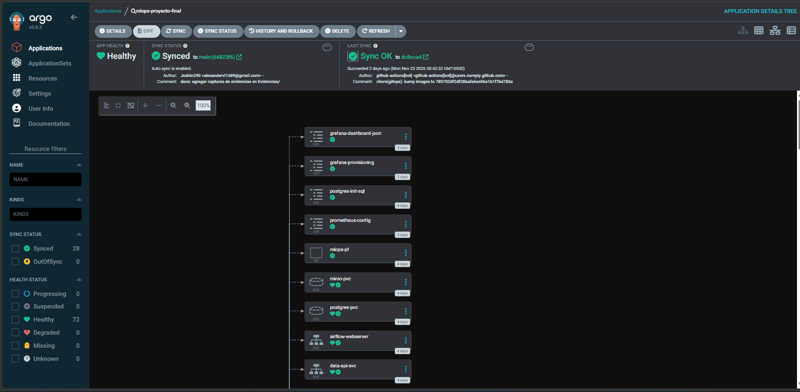
</p>

### 2. Configuración del Origen GitOps e Imágenes Desplegadas

La vista de detalles de la aplicación valida que Argo CD monitorea directamente el repositorio `https://github.com/Joshin290/Proyecto_Final_MLOPS.git` en la rama `main` y la ruta recursiva `k8s`, desplegando sobre el clúster local (`in-cluster`) en el namespace `mlops-pf` con creación automática de namespace (`CreateNamespace`) y políticas activas de depuración (`prune: true`) y autorreparación (`selfHeal: true`). En la sección `IMAGES` se confirma que los cinco microservicios propios (`airflow`, `fastapi`, `locust`, `mlflow` y `streamlit`) corren de forma uniforme con la etiqueta inmutable `789702df2df28bafa6ee06a1b1f7bd783e92a0c5`, junto a los servicios base (`postgres:15-alpine`, `minio`, `prometheus`, `grafana` y `data-api`).

<p align="center">
  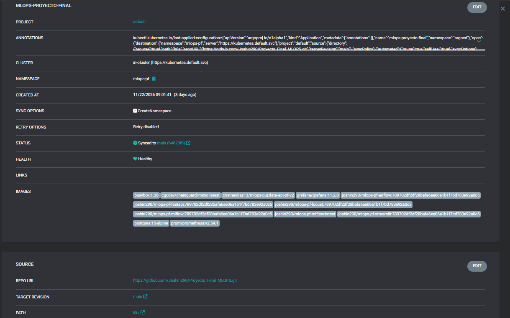
</p>

### 3. Trazabilidad entre GitHub Actions y Docker Hub

La integración continua automatiza la actualización de versiones sin editar los archivos YAML manualmente. Al completarse el *build* de las imágenes en Docker Hub, el workflow de GitHub Actions generó el commit automático `dc8eca4` (`chore(gitops): bump images to 789702d [skip ci]`), modificando los 5 manifiestos correspondientes (`04-mlflow.yaml`, `05-airflow.yaml`, `06-fastapi.yaml`, `07-streamlit.yaml` y `08-locust.yaml`) para reemplazar el hash anterior (`016b637...`) por el nuevo (`789702d...`) e incluyendo `[skip ci]` para evitar ciclos infinitos de ejecución.

<p align="center">
  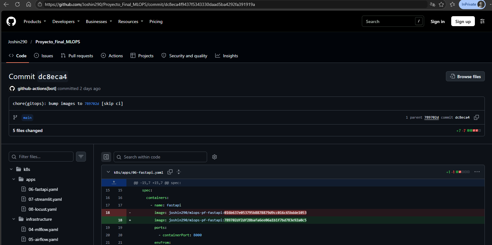
</p>

En paralelo, la verificación en Docker Hub (por ejemplo, en el repositorio `joshin290/mlops-pf-airflow`) confirma la publicación de la etiqueta exacta `789702df2df28bafa6...` junto a `latest` y los historiales de commits previos, registrando además descargas recientes (*pulled*) directamente desde el clúster de Kubernetes.

<p align="center">
  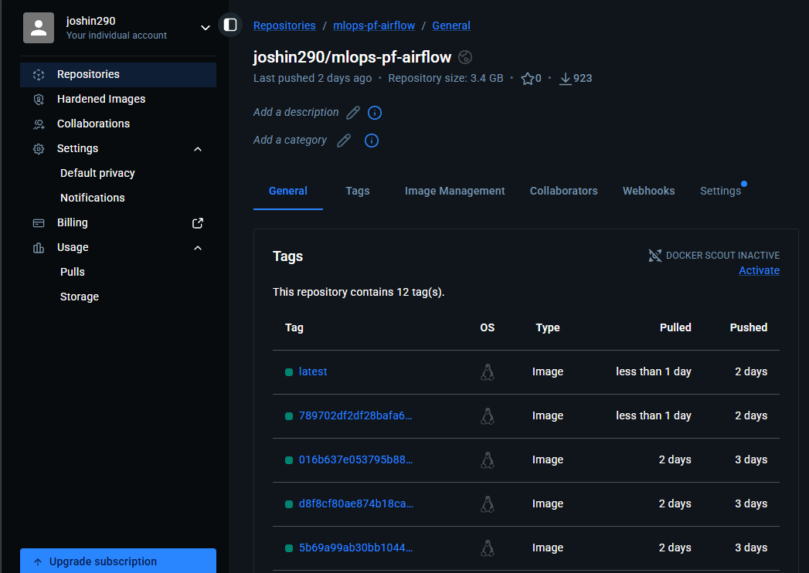
</p>

### 4. Resultado de la Sincronización e Historial de Despliegues (*Rollback*)

El detalle de la operación `Sync` verifica que la actualización hacia la revisión `dc8eca4` fue disparada por `automated sync policy`, completándose en **3 segundos** en fase **`Succeeded`** (`successfully synced (all tasks run)`) y manteniendo intactos los recursos persistentes y de configuración (`Namespace`, `ConfigMap` y `PersistentVolumeClaim` en estado `Synced`/`Healthy`).

<p align="center">
  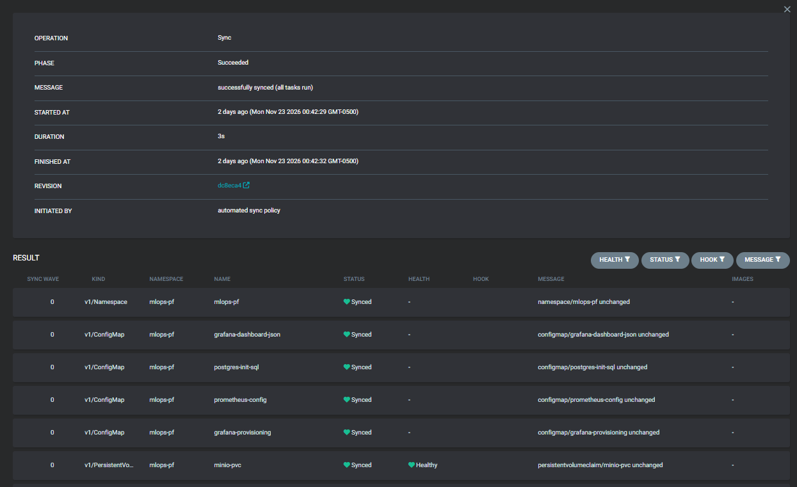
</p>

Finalmente, la pestaña `HISTORY AND ROLLBACK` conserva la línea de tiempo completa de despliegues automáticos —desde la revisión previa `119b051` hasta la versión vigente `dc8eca4`, ambas aplicadas en 3 segundos por la política automática—, lo que garantiza auditoría completa del ciclo de vida y capacidad inmediata de reversión (*rollback*) ante cualquier incidente.

<p align="center">
  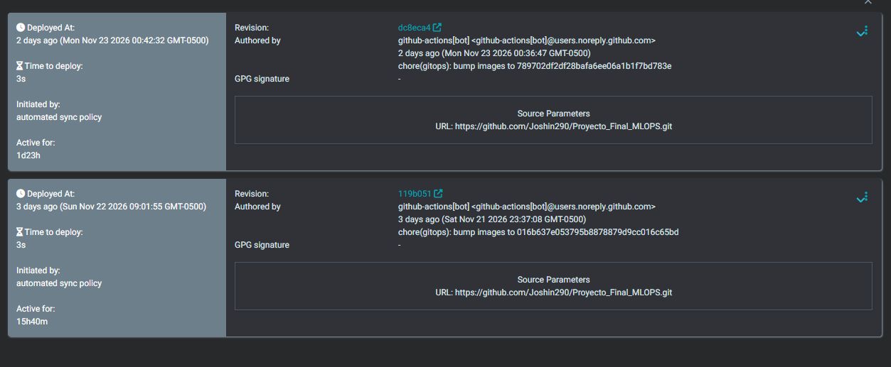
</p>

---

### Pruebas de Ejecución y Análisis de Resultados

Para validar el ciclo completo de **entrenamiento continuo (CT)**, gobernanza de modelos, trazabilidad de artefactos y explicabilidad, se ejecutó el pipeline `real_estate_mlops_dag` desde un estado limpio (PostgreSQL, MLflow, MinIO y Airflow reiniciados) consumiendo secuencialmente la totalidad de los lotes entregados por la `Data API` (`group_number=3`, `day=Tuesday`).

En total se realizaron **8 ejecuciones del DAG en Airflow**: **6 corridas exitosas** que procesaron **1,080,263 registros limpios** (generando las versiones `v1` a `v6` en MLflow) y **2 ejecuciones adicionales de validación de fin de datos (ejecuciones 7 y 8)**, logrando evidenciar en operación real todos los escenarios críticos del sistema: creación de línea base, reentrenamiento por *data drift* y nuevas categorías geográficas, rechazo automático de candidatos inferiores, recuperación frente a cambios severos de distribución y control determinístico de errores HTTP.

<p align="center">
  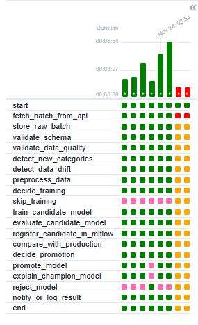
</p>


<p align="center">
  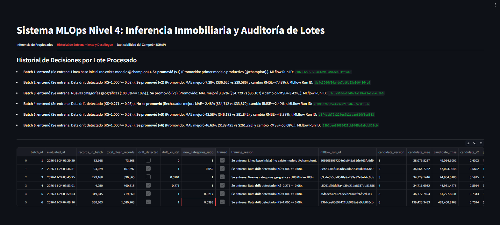
</p>
---


A continuación se va a dar mayor detalle acerca de tres ejecuciones del DAG, dos donde se presentó una promoción del modelo y una en la que el modelo fue rechazado.

### Ejecución 3 (Batch 3):

- **Ejecución en Airflow:** `real_estate_mlops_dag` · `2026-11-24 03:41:12 UTC`
- **Registro en MLflow:** `batch_3_training` (`c3cde555da8540a9a299a92e3eb4c6b5`)
- **Modelo generado:** `real_estate_pricer` **v3** (promovido a `@champion`)
- **Versión del código (Git):** `789702df2df28bafa6ee06a1b1f7bd783e92a0c5`
- **Datos acumulados:** `396,565` registros limpios (`batches_used = 1,2,3`)

<p align="center">
  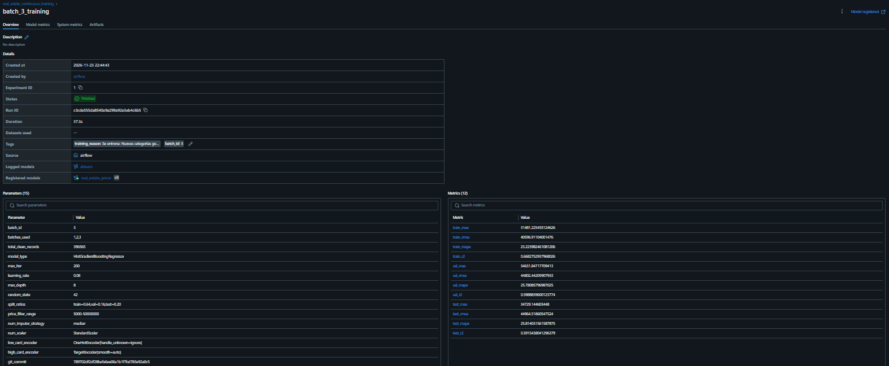
</p>

El sistema decidió entrenar el modelo v3 durante el Batch 3 porque, al recibir 229,168 nuevos registros (llevando el acumulado a 396,565 datos limpios), detectó la llegada masiva de nuevas categorías geográficas en el 100.0% del lote, superando ampliamente el umbral mínimo del 10% definido para activar el reentrenamiento. Aunque en esta iteración no se detectó data drift en la distribución numérica (el estadístico KS fue de apenas 0.0201, muy por debajo del límite de 0.08), la regla automática de decisión determinó que era necesario entrenar un nuevo candidato para que aprendiera estas ubicaciones inéditas que la versión anterior (v2) no había visto, permitiéndole adaptarse a los nuevos mercados y mejorar el desempeño lo suficiente como para ser promovido.

#### Análisis de SHAP

- **Importancia global de variables:** Muestra el ranking de los factores que más pesan en el precio estimado por el modelo v3. El código postal (zip_code) y el tamaño de la vivienda (house_size) lideran con claridad, seguidos por la cantidad de baños (bath), el corredor (brokered_by) y el estado (state), mientras que variables como bed, status y years_since_sold tienen una influencia mucho menor.

<p align="center">
  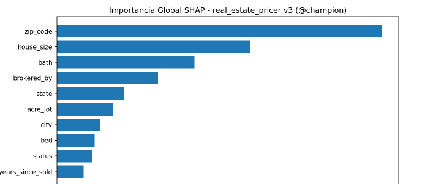
</p>


- **Dirección e impacto de cada variable (Beeswarm):** Detalla cómo los valores altos (rojo) o bajos (azul) de cada característica empujan el precio hacia arriba o hacia abajo. El comportamiento coincide con la lógica del mercado: códigos postales más cotizados, casas más grandes, mayor número de baños y propiedades en venta (status_for_sale) o ubicadas en Florida (state_Florida) elevan el valor estimado, mientras que un mayor tiempo desde la última venta (years_since_sold) tiende a reducirlo ligeramente.

<p align="center">
  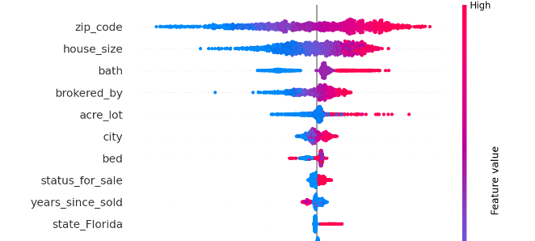
</p>


- **Explicación local de una propiedad de precio alto (Waterfall):** Parte del precio promedio base del modelo ($196,753.45) hasta alcanzar una estimación de $266,500.71. El aumento se explica principalmente por la ubicación (zip_code = 12589.0: +$34,185.45 y city = Wallkill, Nueva York), el tamaño (1,780 ft²: +$14,379.37) y el corredor (+$10,796.27), con una leve disminución solo por figurar como vendida (status = sold: -$1,500.15).

<p align="center">
  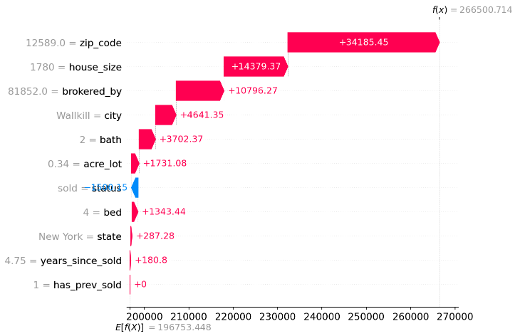
</p>


- **Explicación local de una propiedad de precio bajo (Waterfall):** Parte del mismo valor base ($196,753.45) y desciende hasta $114,087.40. La caída está marcada por la ubicación y el corredor (zip_code = 66749.0: -$59,961.57, brokered_by: -$22,896.44, lote de 0.16 acres: -$12,880.04 y su localización en Iola, Kansas), factores que pesan más que el efecto positivo de contar con una casa amplia (2,819 ft²: +$21,759.25) y 2 baños (+$4,683.56).

<p align="center">
  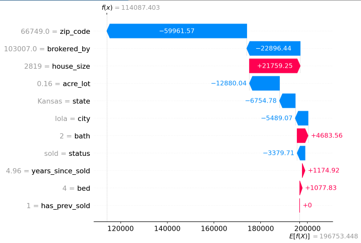
</p>


- **Efecto del tamaño de la vivienda (Dependencia SHAP):** Representa cómo cambia el aporte de house_size (recortado al percentil 99) según los pies cuadrados de la propiedad. Las viviendas por debajo de ~1,400 ft² restan valor respecto al promedio (hasta cerca de -$60,000 USD), mientras que por encima de ese umbral el impacto se vuelve positivo y crece de forma sostenida hasta estabilizarse entre +$20,000 y +$35,000 USD a partir de los 2,200 ft².

<p align="center">
  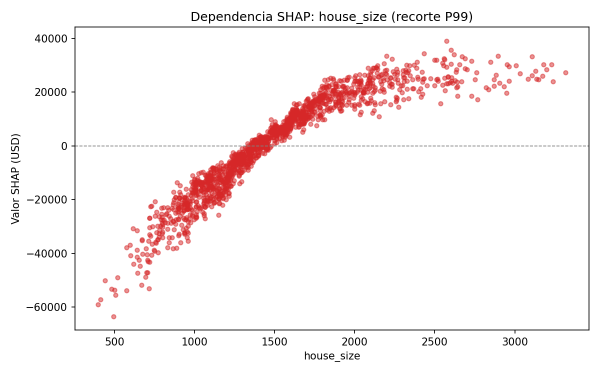
</p>


### Ejecución 4 (Batch 4):

- **Ejecución en Airflow:** `real_estate_mlops_dag` · `2026-11-24 03:53:01 UTC`
- **Registro en MLflow:** `batch_4_training` (`c5091d26dd5a4a39a21ba8757ab81356`)
- **Modelo generado:** `real_estate_pricer` **v4** (rechazado — **v3** se mantiene como `@champion`)
- **Versión del código (Git):** `789702df2df28bafa6ee06a1b1f7bd783e92a0c5`
- **Datos acumulados:** `400,615` registros limpios (`batches_used = 1,2,3,4`)

<p align="center">
  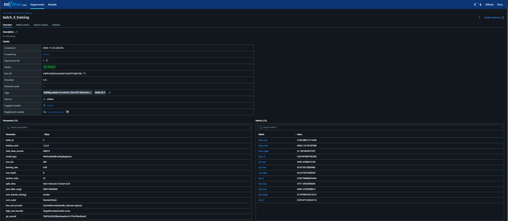
</p>

Durante el Batch 4, el sistema decidió entrenar el modelo **v4** porque detectó un cambio en la distribución de los datos (*data drift*) con un estadístico **KS de 0.271**, superando el umbral de **0.08**, además de la llegada de nuevas categorías geográficas. Sin embargo, este lote aportó únicamente **4,050 registros nuevos** (apenas un 1% adicional sobre el acumulado previo de 396,565 datos), lo cual fue insuficiente para mejorar el aprendizaje del modelo frente a la versión que ya estaba en producción.

Al comparar ambos modelos sobre el mismo conjunto de prueba, **v4** obtuvo un desempeño inferior al campeón vigente (**v3**): su error promedio (MAE) subió de **$33,870** a **$34,712** (un empeoramiento del **2.48%**, lejos de la mejora mínima exigida del **3%**) y su RMSE aumentó en un **2.40%** (de **$43,908** a **$44,961**, superando el límite máximo de tolerancia del **1%**). Al incumplir las dos reglas de promoción, la compuerta `decide_promotion` activó automáticamente la rama `reject_model`, descartó **v4** como candidato y protegió la API manteniendo intacta la versión **v3** en producción.


### Ejecución 6 (Batch 6):

- **Ejecución en Airflow:** `real_estate_mlops_dag` · `2026-11-24 04:08:16 UTC`
- **Registro en MLflow:** `batch_6_training` (`93b2cee60692421bb9f65a9a9cb820cb`)
- **Modelo generado:** `real_estate_pricer` **v6** (promovido a `@champion` definitivo)
- **Versión del código (Git):** `789702df2df28bafa6ee06a1b1f7bd783e92a0c5`
- **Datos acumulados:** `1,080,263` registros limpios (`batches_used = 1,2,3,4,5,6`)

<p align="center">
  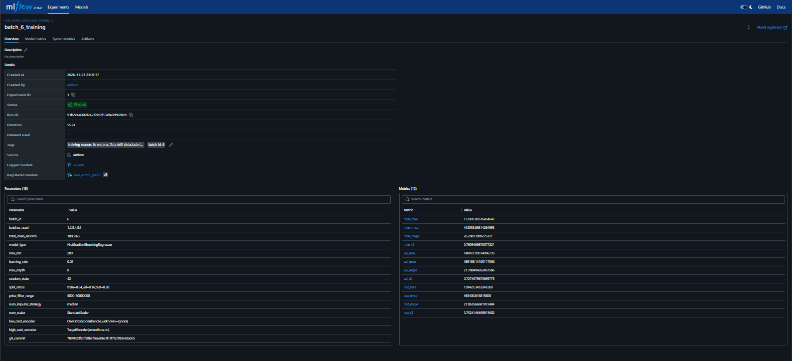
</p>

El sistema decidió entrenar el modelo **v6** durante el Batch 6 porque, al recibir **360,603 nuevos registros** (el lote más grande del ciclo, superando el millón de propiedades acumuladas), detectó un fuerte cambio en la distribución de los datos (*data drift*) con un estadístico **KS de 1.000**, muy por encima del umbral de **0.08**. Al compararse frente al campeón vigente (**v5**) sobre el conjunto de prueba actualizado, **v6** redujo el error promedio (MAE) en un **46.63%** (`$139,425` frente a `$261,226`) y bajó el RMSE en un **50.08%**, logrando la promoción automática a producción y la recarga en caliente en FastAPI.

#### ¿En qué mejoró el Batch 6 (`v6`) frente al Batch 3 (`v3`)?

- **Mayor capacidad explicativa ($R^2$):** Es la mejora más clara entre ambos modelos. Mientras `v3` explicaba el **59.15%** de la variación de los precios en prueba (`test_r2 = 0.5915`), `v6` alcanzó un **75.24%** (`test_r2 = 0.7524`), lo que representa un salto de **+16.09 puntos porcentuales** (y subió también en validación de `0.5989` a `0.7275` y en entrenamiento de `0.6683` a `0.7809`).
- **Cobertura casi 3 veces mayor y adaptación a mercados de alto valor:** `v6` pasó de entrenarse con `396,565` registros a **1,080,263 registros** (`2.7x` más datos), incorporando estados costosos y viviendas de gama alta que `v3` aún no conocía. Esto se refleja en el precio base promedio del modelo, que pasó de `$196,753` en `v3` a **`$566,497`** en `v6`.
- **Estabilidad del error porcentual (MAPE) pese al cambio de escala:** Aunque el error en dólares (MAE y RMSE) aumentó frente a `v3` (`$139,425` vs. `$34,729`) debido a que el mercado analizado ahora incluye viviendas de millones de dólares, el **error porcentual relativo (MAPE)** se mantuvo prácticamente estable (**27.86%** en `v6` frente a **25.81%** en `v3`, apenas `+2.05` puntos de diferencia para un rango de precios mucho más amplio y complejo).
- **Mejor comprensión de propiedades grandes y nuevos estados:** En `v3`, el efecto del tamaño de la casa dejaba de crecer alrededor de los `2,200 ft²`, mientras que `v6` aprendió a valorar de forma continua viviendas de hasta `6,000 ft²`. Además, la variable `state` ganó peso (subiendo al 4.º lugar global y superando a `brokered_by`), permitiendo diferenciar mercados premium como California, Florida, Washington y Arizona.

#### Análisis de SHAP

- **Importancia global de variables:** Muestra el ranking de los factores que más influyen en las predicciones de `v6`. Al igual que en `v3`, el código postal (`zip_code`, con un impacto medio cercano a `$179,000 USD`) y el tamaño de la vivienda (`house_size`, ~`$131,000 USD`) dominan el cálculo, seguidos por los baños (`bath`), el estado (`state` —que escala una posición respecto a `v3`—) y el corredor (`brokered_by`).

<p align="center">
  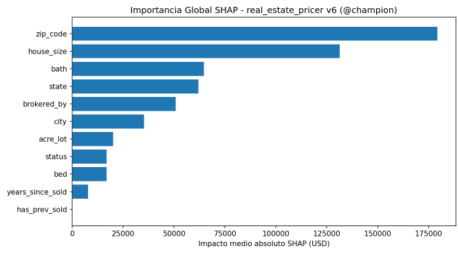
</p>

- **Dirección e impacto de cada variable (Beeswarm):** Confirma cómo los valores altos (rojo) de `zip_code`, `house_size`, `bath` y `brokered_by` impulsan el precio al alza con impactos que ahora llegan a millones de dólares en propiedades de lujo. A diferencia de `v3` (donde solo destacaba `state_Florida`), en `v6` aparecen claramente nuevos estados de alto valor empujando las estimaciones hacia arriba, como `state_California`, `state_Florida`, `state_Washington` y `state_Arizona`.

<p align="center">
  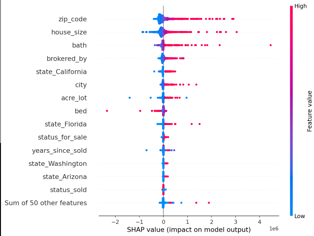
</p>

- **Explicación local de una propiedad de precio alto (Waterfall):** Parte del precio base del modelo (`$566,497.18`) y llega a una estimación de **`$1,455,247.51`**. El aumento responde sobre todo a una vivienda muy amplia (`house_size = 5,400 ft²`: `+$811,585.56`), el corredor (`brokered_by = 95772.0`: `+$223,849.41`) y la ubicación en Florida (`+$218,610.63`), compensado en parte por el código postal (`33463.0`: `-$175,282.24`) y la ciudad (`Greenacres`: `-$85,874.79`).

<p align="center">
  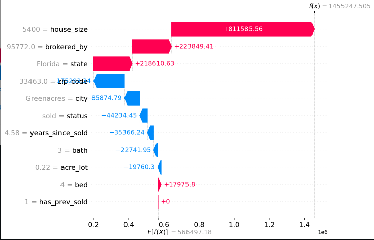
</p>

- **Explicación local de una propiedad de precio bajo (Waterfall):** Parte del mismo valor base (`$566,497.18`) y baja hasta **`$173,541.17`**. La reducción se explica por la combinación de ubicación económica y dimensiones reducidas: `zip_code = 64114.0` (`-$135,984.49`), `house_size = 1,001 ft²` (`-$116,993.85`), 1 baño (`-$58,487.08`), corredor (`-$37,662.16`), estado de Missouri (`-$30,564.02`) y ciudad de Kansas City (`-$16,267.21`), con un leve ajuste positivo por estar activa en venta (`status = for_sale`: `+$13,258.02`).

<p align="center">
  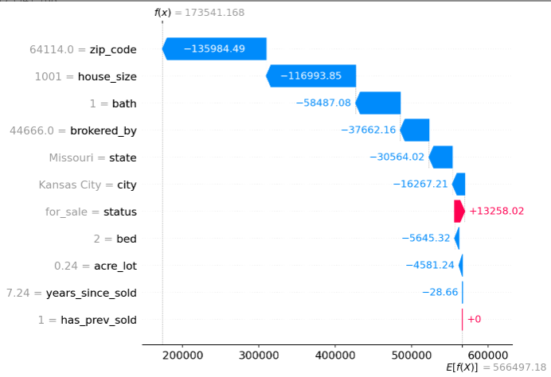
</p>

- **Efecto del tamaño de la vivienda (Dependencia SHAP):** Muestra la relación entre `house_size` (recortado al percentil 99) y su aporte en dólares. A diferencia de `v3` —donde el efecto se aplanaba a partir de `2,200 ft²`—, en `v6` ese punto marca apenas el cruce hacia aportes positivos y la curva continúa subiendo de forma sostenida hasta los `6,000 ft²`, alcanzando contribuciones entre `+$500,000` y más de `+$1,000,000 USD` en propiedades de gran tamaño.

<p align="center">
  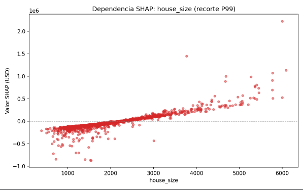
</p>

### Dinámica de *Data Drift*, Acumulación de Datos y Control de Fin de Lotes

Durante las seis primeras ejecuciones, el *data drift* se originó porque la `Data API` entrega el conjunto inmobiliario de forma progresiva por segmentos de mercado y zonas geográficas diferenciadas, generando desplazamientos marcados en la distribución de precios y atributos (`KS = 1.000` en los lotes 2, 5 y 6; `KS = 0.271` en el lote 4; y `100.0%` de nuevas categorías geográficas en el lote 3). Debido a esta variabilidad entre entregas, en las seis corridas exitosas la compuerta automática `decide_training` activó el entrenamiento tras validar esquema, calidad y no duplicidad: el **Batch 1** construyó la línea base inicial al no existir un `@champion` previo, los **Batches 2, 4, 5 y 6** superaron el umbral de *drift* (`KS >= 0.08`) y el **Batch 3**, pese a presentar un *drift* numérico bajo (`KS = 0.0201`), excedió ampliamente el límite de categorías inéditas (`100.0% >= 10%`), por lo que en ninguna de estas iteraciones se cumplieron las condiciones de estabilidad requeridas para ejecutar `skip_training`. En cada ejecución válida, el pipeline acumula los nuevos registros limpios en PostgreSQL en lugar de sobrescribir los anteriores —creciendo desde `73,368` filas en el Batch 1 hasta `1,080,263` en el Batch 6— con el fin de incorporar mercados de mayor escala sin perder el conocimiento histórico; a su vez, la diferencia en el volumen por lote (desde `4,050` registros en el Batch 4 hasta `360,603` en el Batch 6) responde tanto a la partición desigual de la API externa como al descarte de filas durante la depuración en `preprocess_data`. Finalmente, el fallo en las **ejecuciones 7 y 8** no correspondió a un defecto del modelo ni del código, sino a que la `Data API` agotó los seis lotes disponibles y retornó `HTTP 400 Bad Request` (`"Ya se recolectó toda la información minima necesaria"`), lo que activó en `fetch_batch_from_api` los cuatro intentos controlados de Airflow (1 intento inicial y 3 reintentos) y detuvo las etapas posteriores en estado `upstream_failed`, evitando ocultar el fin de datos como una corrida exitosa y conservando íntegros los registros en PostgreSQL y el modelo `@champion` (`v6`) en producción.

<p align="center">
  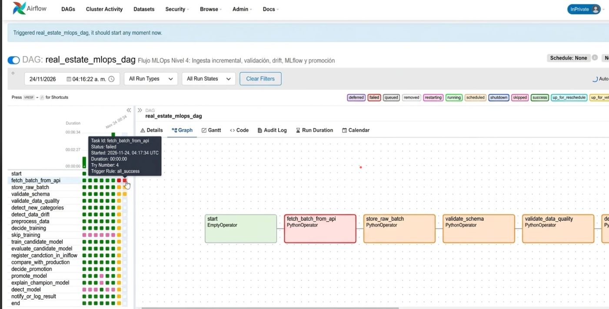
</p>


<p align="center">
  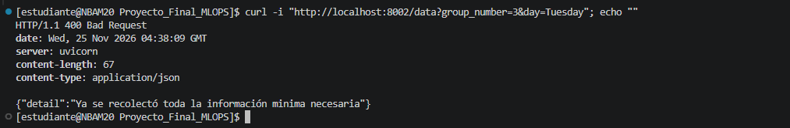
</p>


#### ¿Por qué se decidió entrenar un modelo en los 6 lotes exitosos?

En las seis ejecuciones exitosas del DAG, la compuerta automática `decide_training` activó el entrenamiento porque **ningún lote cumplió las condiciones de estabilidad** requeridas para omitir el proceso (`skip_training`). La `Data API` no entrega muestras aleatorias homogéneas del mismo segmento, sino bloques particionados por distintas zonas geográficas y franjas de precio; al comparar cada lote entrante contra el histórico acumulado en PostgreSQL, todos activaron al menos una regla de reentrenamiento:

| Lote | Regla que disparó el entrenamiento | Evidencia registrada |
| :---: | :--- | :--- |
| **Batch 1 (`v1`)** | Ausencia de modelo en producción | Creación obligatoria de la línea base inicial (`@champion`) |
| **Batch 2 (`v2`)** | *Data drift* numérico | `KS = 1.000` (supera el umbral `>= 0.08`) |
| **Batch 3 (`v3`)** | Nuevas categorías geográficas | `100.0%` de categorías inéditas (`>= 10%`), pese a `KS = 0.0201` |
| **Batch 4 (`v4`)** | *Data drift* numérico | `KS = 0.271 >= 0.08` (además de `100.0%` de nuevas categorías) |
| **Batch 5 (`v5`)** | *Data drift* numérico | `KS = 1.000 >= 0.08` por ingreso de propiedades de mayor valor |
| **Batch 6 (`v6`)** | *Data drift* numérico | `KS = 1.000 >= 0.08` por incorporación de mercados de escala superior |

Este comportamiento confirma que el pipeline no reentrenó de manera indiscriminada, sino que respondió a disparadores distintos según el contenido de cada entrega (línea base en el lote 1, novedad geográfica en el lote 3 y desplazamiento estadístico en los lotes 2, 4, 5 y 6). La rama `skip_training` habría entrado en acción únicamente si un lote hubiera mantenido una distribución estable (`KS < 0.08`) y menos de un `10%` de categorías nuevas, escenario que no se presentó en los datos suministrados por la API.


### 1. Evolución del Entrenamiento Continuo y Decisiones por Ejecución

| Ejecución / Lote | Filas del Lote | Acumulado Limpio | Regla de Disparo (`decide_training`) | Versión y Duración MLflow | Métricas Candidato (MAE / RMSE / $R^2$) | Comparación vs. `@champion` Vigente | Decisión (`decide_promotion`) |
| :---: | :---: | :---: | :--- | :---: | :--- | :--- | :---: |
| **Ejecución 1 (Batch 1)** | 73,368 | 73,368 | Línea base inicial (sin `@champion`) | `v1` (42.1 s) | `$38,079.53` / `$49,064.30` / `0.4302` | Primer modelo productivo | **Promovido (`v1`)** |
| **Ejecución 2 (Batch 2)** | 94,029 | 167,397 | *Data drift* (`KS = 1.000 >= 0.08`) | `v2` (30.5 s) | `$36,664.77` / `$47,023.90` / `0.5602` | MAE `-7.38%` (`$36,665` vs `$39,586`) · RMSE `-7.43%` | **Promovido (`v2`)** |
| **Ejecución 3 (Batch 3)** | 229,168 | 396,565 | Nuevas categorías (`100.0% >= 10%`) | `v3` (37.3 s) | `$34,729.14` / `$44,964.52` / `0.5915` | MAE `-3.82%` (`$34,729` vs `$36,107`) · RMSE `-3.42%` | **Promovido (`v3`)** |
| **Ejecución 4 (Batch 4)** | 4,050 | 400,615 | *Data drift* (`KS = 0.271 >= 0.08`) | `v4` (5.7 s) | `$34,711.70` / `$44,961.43` / `0.5914` | Mejora MAE `-2.48%` (`$34,712` vs `$33,870`) · RMSE `+2.40%` | **Rechazado (`v3` vigente)** |
| **Ejecución 5 (Batch 5)** | 319,045 | 719,660 | *Data drift* (`KS = 1.000 >= 0.08`) | `v5` (36.9 s) | `$46,172.75` / `$61,227.65` / `0.7343` | MAE `-43.58%` (`$46,173` vs `$81,842`) · RMSE `-43.38%` | **Promovido (`v5`)** |
| **Ejecución 6 (Batch 6)** | 360,603 | 1,080,263 | *Data drift* (`KS = 1.000 >= 0.08`) | `v6` (55.2 s) | `$139,425.34` / `$463,400.82` / `0.7524` | MAE `-46.63%` (`$139,425` vs `$261,226`) · RMSE `-50.08%` | **Promovido (`v6 @champion`)** |
| **Ejecución 7** | — | 1,080,263 | `HTTP 400` (*fin de datos disponibles*) | — | Sin entrenamiento | 4 intentos controlados (`retries=3`); `@champion v6` intacto | **Detenido (`failed`)** |
| **Ejecución 8** | — | 1,080,263 | `HTTP 400` (*fin de datos disponibles*) | — | Sin entrenamiento | Revalidación determinística; `@champion v6` intacto | **Detenido (`failed`)** |

---

### 2. Interpretación Técnica de los Resultados

1. **Activación heterogénea de reglas de entrenamiento (`decide_training`):**
   - El pipeline no reentrenó de forma ciega; respondió automáticamente a distintos disparadores técnicos: creación de línea base (**Batch 1**), desplazamiento estadístico de distribución mediante prueba de Kolmogorov-Smirnov (**Batches 2, 4, 5 y 6**) e irrupción de nuevas categorías geográficas sin *drift* numérico significativo (**Batch 3**, donde `KS = 0.0201 < 0.08` pero `new_categories_ratio = 100.0% >= 10%`).

2. **Protección de producción ante degradación (**Ejecución 4 — Candidato `v4` rechazado**):**
   - El lote 4 aportó únicamente **4,050 registros** (~1 % del acumulado). Aunque superó el umbral de *drift* (`KS = 0.271`), al evaluarse contra `v3` sobre el mismo conjunto de prueba su desempeño empeoró (**MAE aumentó 2.48 %** y **RMSE aumentó 2.40 %**).
   - La compuerta `decide_promotion` rechazó automáticamente `v4` (`challenger_rejected`), omitió el cálculo de SHAP y mantuvo `v3` sirviendo en FastAPI sin interrupción.

3. **Efecto del *Data/Concept Drift* y cambio de escala en los **Batches 5 y 6**:**
   - Aunque el MAE absoluto pasó de ~$34,729 (`v3`) a **$46,172.75 (`v5`)** y **$139,425.34 (`v6`)**, la capacidad explicativa del modelo **mejoró sustancialmente**, elevando el $R^2$ de **`0.4302` (`v1`) hasta `0.7524` (`v6`)**.
   - El aumento en el error medido en dólares responde al ingreso de mercados inmobiliarios de escala muy superior (estados costosos como California, Florida y Washington, junto con propiedades de alto valor). Dado que el `@champion` previo desconocía esas distribuciones y códigos postales, su error se disparó hasta **$81,842** (lote 5) y **$261,226** (lote 6), mientras que el reentrenamiento automático redujo el MAE en **43.58 %** y **46.63 %** respectivamente (y el RMSE en **50.08 %** en el lote 6), demostrando la necesidad operativa del entrenamiento continuo.

4. **Trazabilidad íntegra entre PostgreSQL, MLflow y MinIO:**
   - Cada decisión registrada en `clean_data.training_audit_log` (visible en Streamlit) mantiene correspondencia exacta 1:1 con los **6 runs activos** del experimento `real_estate_continuous_training` en MLflow (`v1` a `v6`) y con las **6 carpetas de artefactos** persistidas en el bucket S3 `mlflow` de MinIO (**15.8 MiB · 66 objetos**, incluyendo modelos serializados y gráficas SHAP).

5. **Resiliencia y consistencia ante fin de datos (**Ejecuciones 7 y 8**):**
   - Al agotarse los 6 lotes de la `Data API`, el servicio respondió `HTTP 400 Bad Request` (`"Ya se recolectó toda la información minima necesaria"`). Tanto en la **ejecución 7** como al revalidar en la **ejecución 8**, Airflow aplicó de forma consistente los **4 intentos controlados** (1 intento inicial + 3 reintentos), detuvo las tareas posteriores (`upstream_failed`) sin enmascarar el error como exitoso y conservó íntegros los registros en PostgreSQL, el Model Registry en MLflow y el modelo `@champion v6` en FastAPI.

---

### Pruebas de carga

Para validar el comportamiento de la API de inferencia (`FastAPI`) bajo tráfico concurrente, se implementó un stack completo de observabilidad y estrés compuesto por **Prometheus**, **Grafana** (aprovisionado de forma declarativa mediante los `ConfigMap` `grafana-dashboard-json` y `grafana-provisioning` en `k8s/`) y **Locust**, desplegados dentro del namespace `mlops-pf`.

### 1. Recolección de Métricas y Validación en Prometheus

FastAPI expone sus métricas en el endpoint `/metrics` y es monitoreado continuamente por Prometheus. En la vista de **Targets** se confirma que tanto `fastapi-inference` (`http://fastapi-svc:8000/metrics`, tiempo de raspado de `3.777 ms`) como `data-api` (`http://data-api-svc/metrics`, `5.783 ms`) operan en estado **`UP`** sin errores.

<p align="center">
  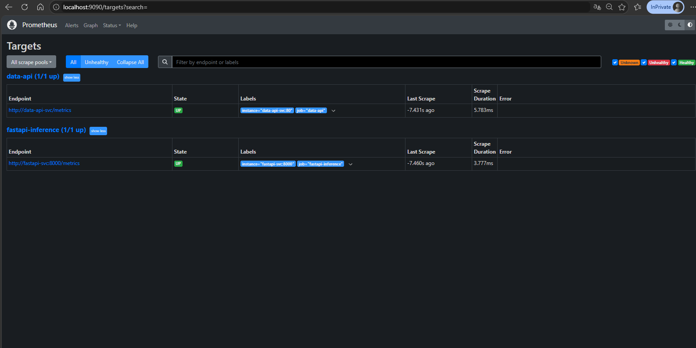
</p>

Asimismo, la consulta directa sobre el indicador `loaded_model_version` valida que la API de inferencia atiende el tráfico con la versión **`6`** (`@champion`), correspondiente al modelo entrenado con el acumulado final de los 6 lotes.

<p align="center">
  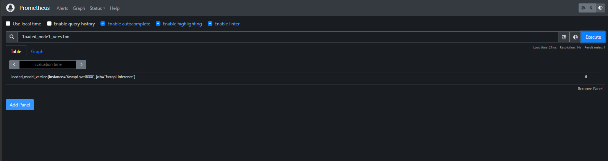
</p>

Durante la inyección de carga, las consultas `inference_requests_total` (etiquetada con `model_version="6"` y `status="success"`) y `rate(inference_requests_total[1m])` registran en tiempo real el incremento sostenido de solicitudes por segundo atendidas por el servicio.

<p align="center">
  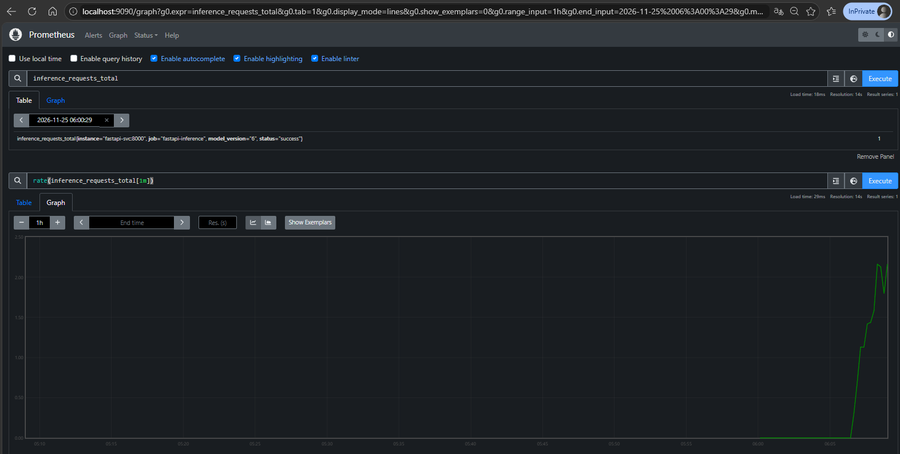
</p>

---

### 2. Ejecución y Resultados de Pruebas de Carga con Locust

Las pruebas se ejecutaron desde el pod de Locust apuntando al servicio interno `http://fastapi-svc:8000` (usando el script `locustfile.py` del repositorio). Para replicarlas localmente basta con habilitar los túneles (`./start-ports.sh`), ingresar a `http://localhost:8089` y definir el perfil de usuarios concurrentes.

Se realizaron **tres corridas escalonadas** (`Run #1`: 10 usuarios, `Run #2`: 50 usuarios y `Run #3`: 100 usuarios concurrentes) para observar tanto la línea base como el comportamiento bajo saturación:

* **Rendimiento y estabilidad:** el sistema procesó **306 peticiones totales** (`249` a `POST /predict` y `57` a `GET /health`) con una tasa de **0% de fallos** (`0` errores) y un rendimiento sostenido de **4.8 RPS** (`4.4 RPS` en `/predict` y `0.4 RPS` en `/health`).
* **Variación de latencia:** en el escenario inicial (`Run #1`, 10 usuarios) la latencia se mantuvo acotada (`P50 ≈ 1.5 s`, `P95 ≈ 2.6 s`). Al escalar hasta `100` usuarios concurrentes (`Run #3`), el tiempo de respuesta aumentó de forma progresiva por encolamiento de solicitudes (`POST /predict` alcanzó mediana de `19,000 ms` y `P95` de `24,000 ms`), sin provocar caídas ni respuestas HTTP de error.

| Endpoint | Peticiones | Fallos | Mediana (ms) | P95 (ms) | Promedio (ms) | RPS |
| :--- | :---: | :---: | :---: | :---: | :---: | :---: |
| `GET /health` | 57 | 0 (0%) | 1,100 | 6,200 | 2,074.19 | 0.4 |
| `POST /predict` | 249 | 0 (0%) | 19,000 | 24,000 | 15,607.50 | 4.4 |
| **Aggregated** | **306** | **0 (0%)** | **15,000** | **24,000** | **13,086.59** | **4.8** |

<p align="center">
  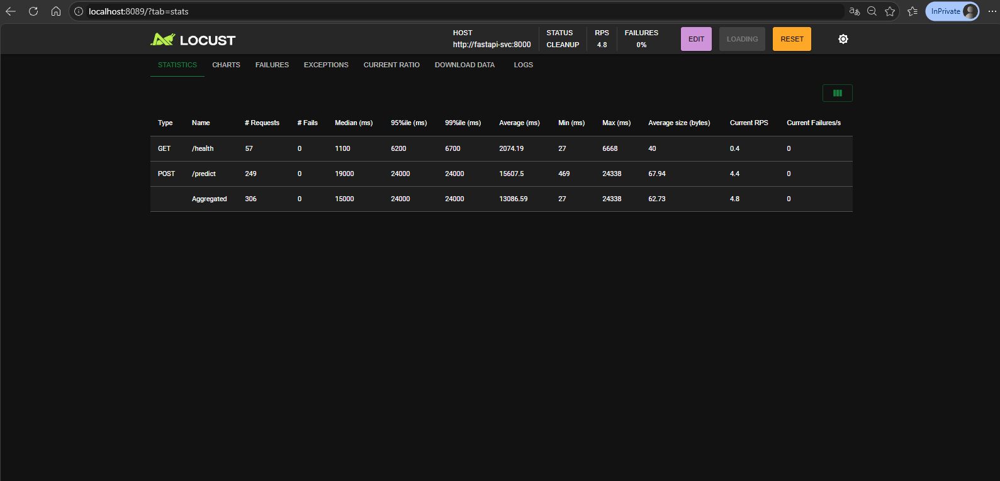
</p>

<p align="center">
  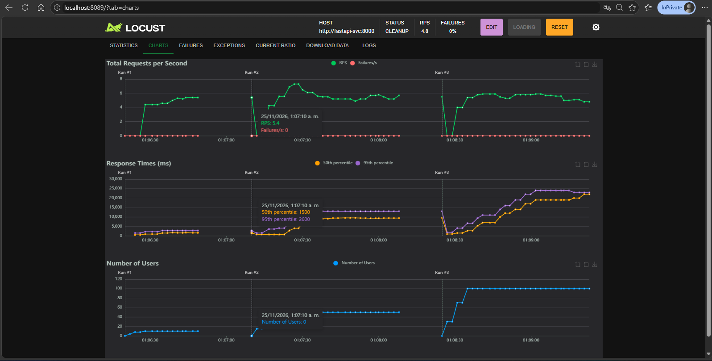
</p>

---

### 3. Visualización del Impacto en Grafana y Consumo de Recursos en Kubernetes

El dashboard declarativo **`MLOps FastAPI & Locust Observability`** en Grafana refleja de forma integrada el impacto de las pruebas de Locust sobre la API:

* **Peticiones por Segundo (RPS):** muestra el incremento de tráfico exitoso durante la ventana de carga (superando los `2.2 RPS` por réplica) y su descenso inmediato al finalizar la prueba.
* **Latencia P95 de Inferencia:** evidencia el aumento de latencia bajo alta concurrencia hasta alcanzar el límite superior del histograma (`10 s`).
* **Versión Activa del Modelo (`@champion`) y Tasa de Errores:** confirma en todo momento la versión **`6`** en producción con **`0 Errors/s`**.
* **Consumo RAM y CPU de FastAPI:** registra un pico pronunciado de uso de CPU coincidente con la ráfaga de inferencias, mientras el consumo de memoria RAM se mantiene estable alrededor de `300–400 MB` sin fugas de memoria.

<p align="center">
  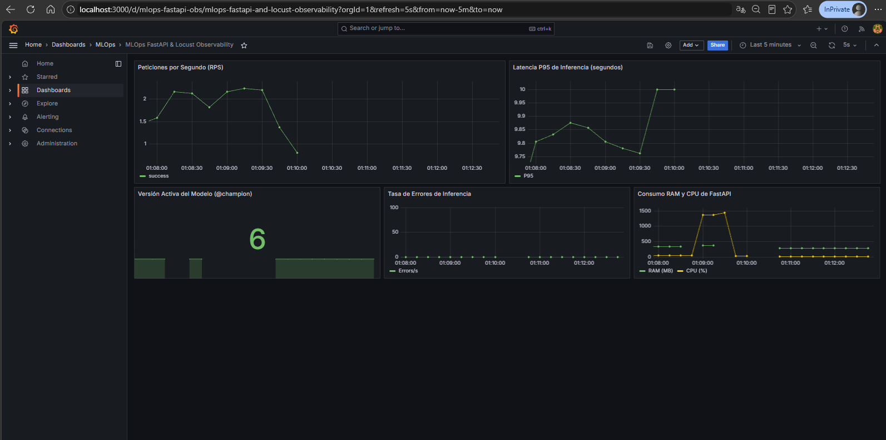
</p>

Complementariamente, el monitoreo directo de recursos en Kubernetes (`kubectl top pods -n mlops-pf`) confirma el balanceo y consumo controlado de las dos réplicas de FastAPI bajo carga (`fastapi-dfc699dc6-wrrzd` en `123m` CPU / `210Mi` RAM y `fastapi-dfc699dc6-6zkzw` en `21m` CPU / `210Mi` RAM), junto con un consumo marginal de los servicios de prueba y observabilidad (`locust`: `2m` / `91Mi`, `grafana`: `2m` / `103Mi`).

<p align="center">
  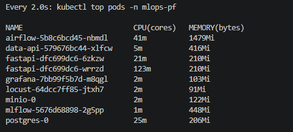
</p>

---

## 9. Evidencias de Despliegue y Operación

A continuación se presentan las evidencias visuales del funcionamiento integral de la plataforma sobre **K3s (`mlops-pf`)**, cubriendo el flujo CI/CD + GitOps, el entrenamiento continuo, el servicio de inferencia, la explicabilidad SHAP y la observabilidad en tiempo real.

---

### 1. CI/CD y GitOps (GitHub Actions, Docker Hub y Argo CD)

- **GitHub Actions (`ci-cd.yml`) — Ejecución del pipeline CI/CD:** evidencia del flujo automatizado de compilación de microservicios y actualización de manifiestos en la rama `main`.
<p align="center">
  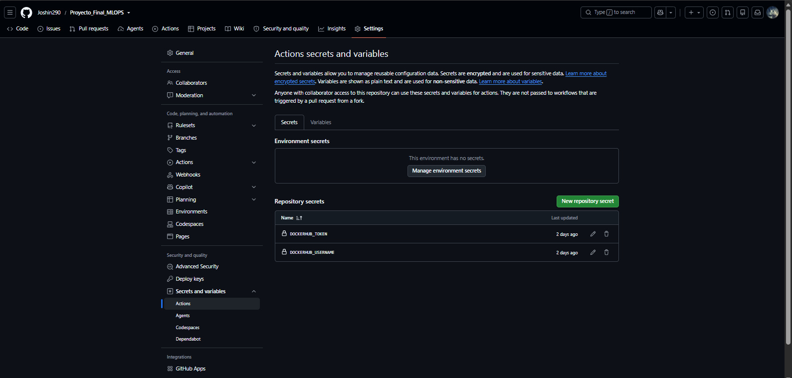
</p>

- **GitHub Actions — Detalle de jobs (`build-and-push` y `update-k8s-manifests`):** validación de la construcción en matriz de las 5 imágenes personalizadas y del commit automático GitOps.
<p align="center">
  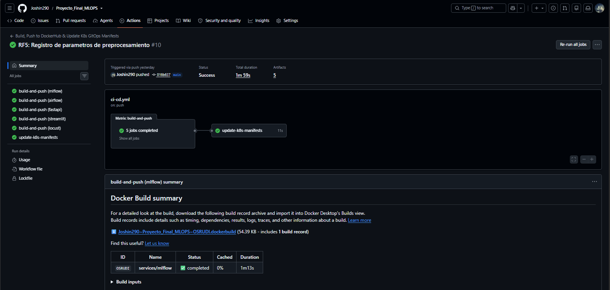
</p>

- **Docker Hub — Repositorios de microservicios (`joshin290`):** registro público con las imágenes generadas para Airflow, MLflow, FastAPI, Streamlit y Locust.
<p align="center">
  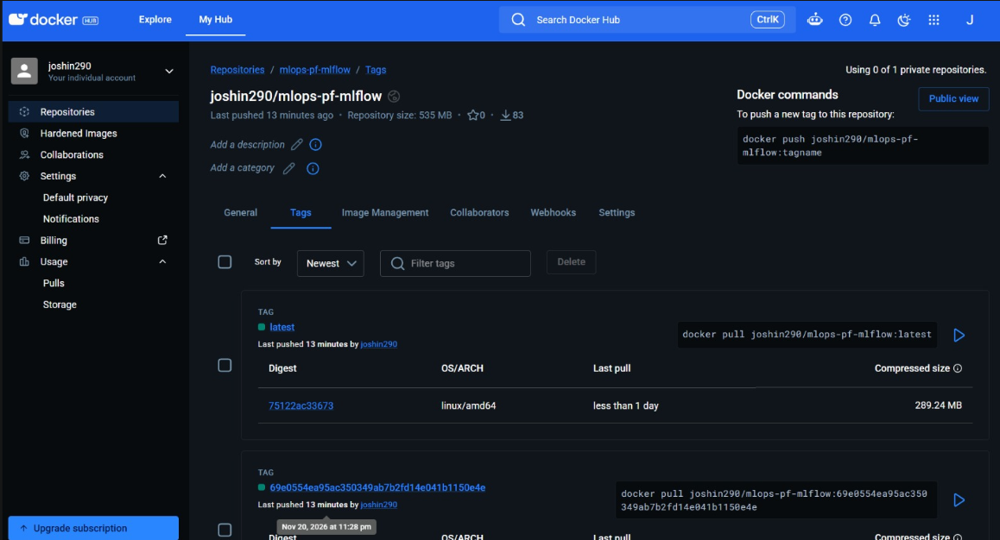
</p>

- **Docker Hub — Etiquetado inmutable por SHA:** publicación de tags asociados al commit SHA y `:latest` utilizados por Argo CD para trazabilidad exacta.
<p align="center">
  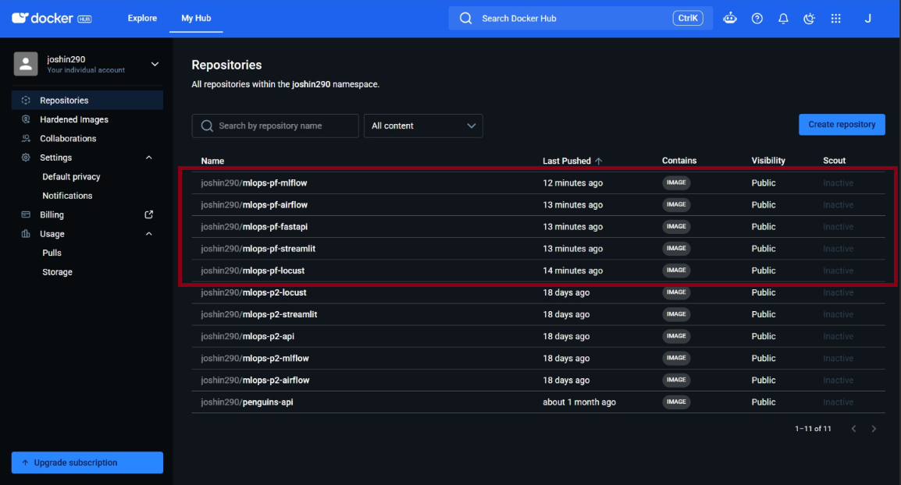
</p>

- **Argo CD — Estado de la aplicación (`Synced` / `Healthy`):** verificación de la sincronización automática de la carpeta `k8s/` desde GitHub hacia el namespace `mlops-pf`.
<p align="center">
  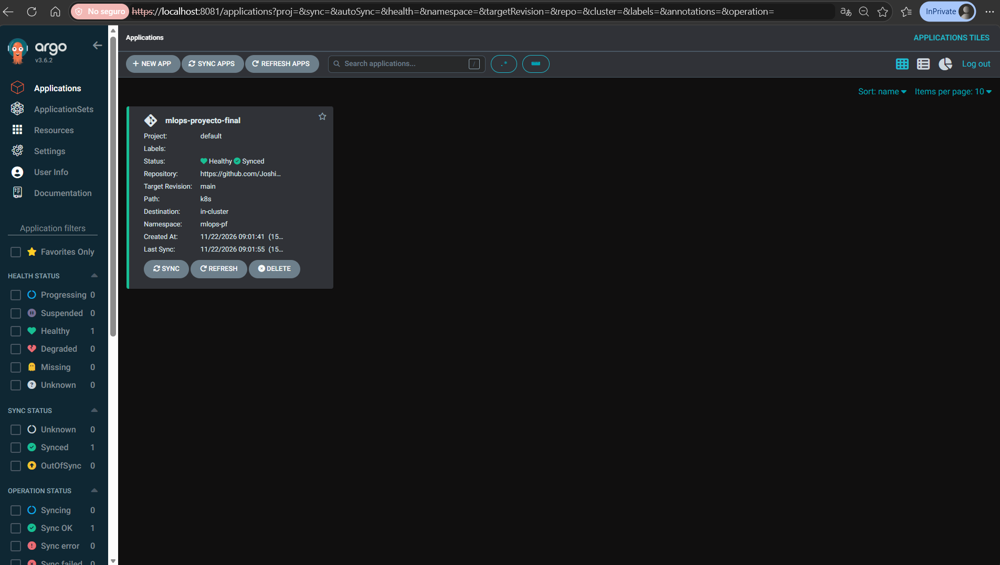
</p>

- **Argo CD — Topología de recursos desplegados (Vista 1):** grafo declarativo de Deployments, Services, Pods y ConfigMaps gestionados por GitOps.
<p align="center">
  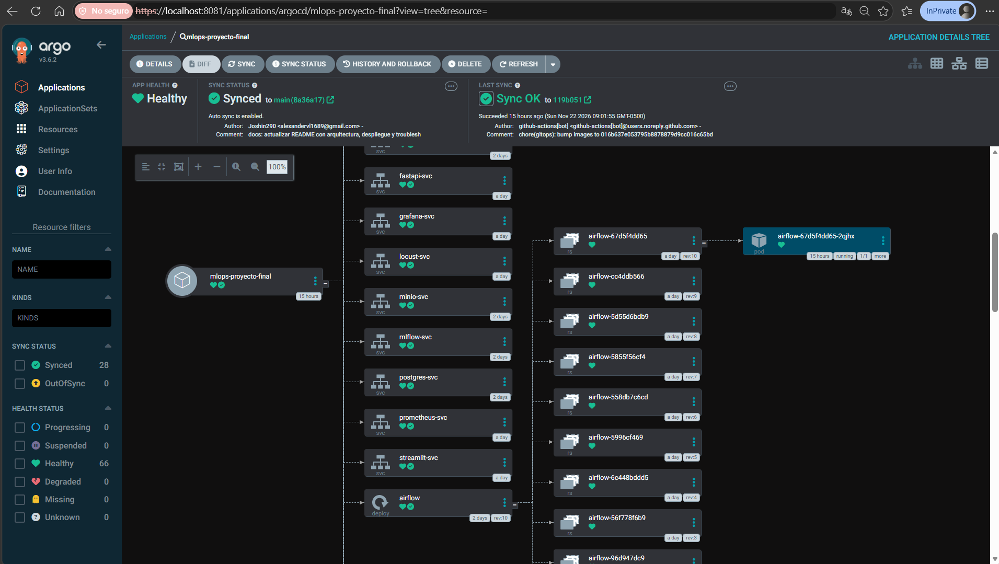
</p>

- **Argo CD — Detalle de sincronización y salud de pods (Vista 2):** verificación de componentes activos y políticas `prune` / `selfHeal` en ejecución.
<p align="center">
  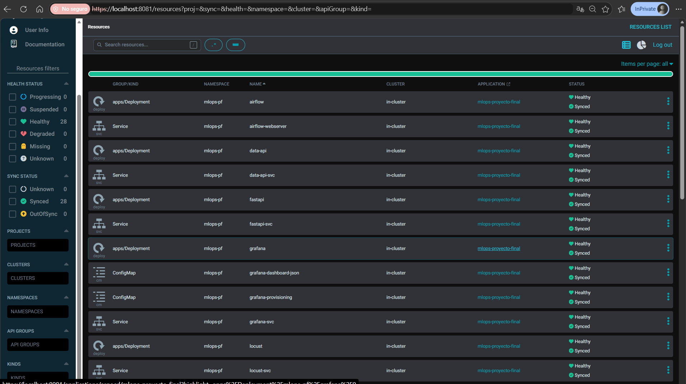
</p>

---

### 2. Ingesta, Orquestación, Tracking y Artefactos (Data API, Airflow, MLflow y MinIO)

- **Data API (`http://localhost:8002/docs`):** interfaz Swagger de la fuente de lotes incrementales configurada con `group_number=3` y `day=Tuesday`.
<p align="center">
  
</p>

- **Apache Airflow (`http://localhost:8080`) — Grafo de `real_estate_mlops_dag` (Vista 1):** etapas de ingesta, almacenamiento `RAW`, validación de esquema/calidad, detección de nuevas categorías y *data drift*.
<p align="center">
  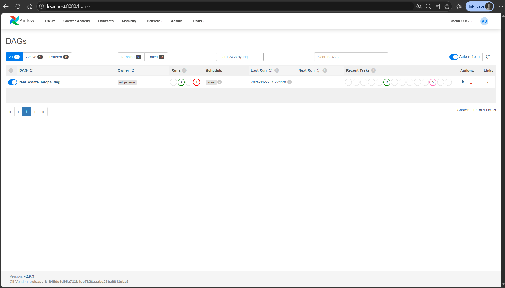
</p>

- **Apache Airflow — Bifurcaciones, promoción y SHAP (Vista 2):** ejecución de `decide_training`, entrenamiento, registro en MLflow, `decide_promotion`, `promote_model`, `explain_champion_model` y auditoría final.
<p align="center">
  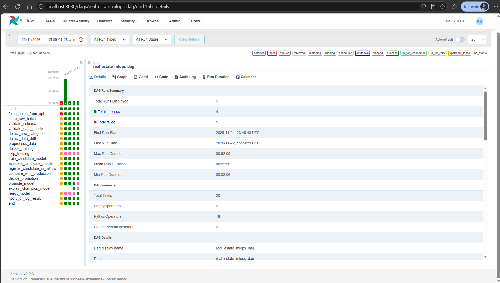
</p>

- **MLflow (`http://localhost:5000`) — Tracking de experimentos:** corridas registradas bajo `real_estate_continuous_training` con parámetros, lotes y métricas (MAE, RMSE, R²).
<p align="center">
  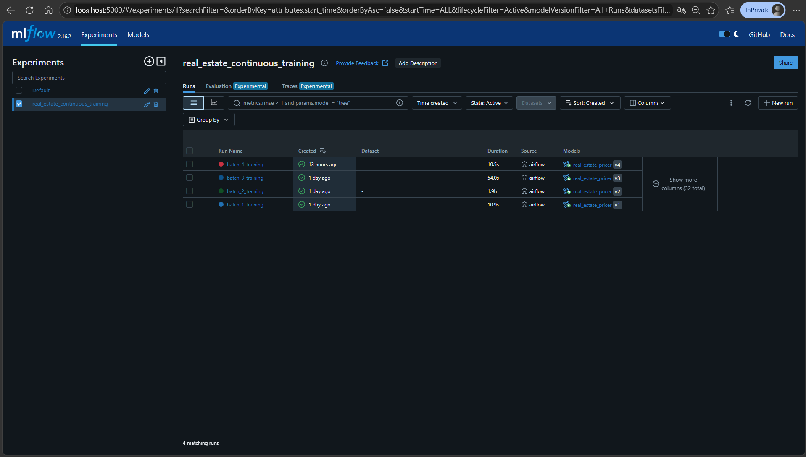
</p>

- **MLflow — Model Registry y alias `@champion`:** historial de versiones de `real_estate_pricer` con asignación automática del alias productivo `@champion` y candidatos rechazados (`challenger_rejected`).
<p align="center">
  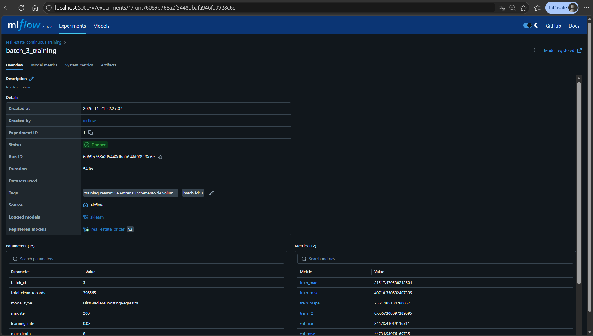
</p>

- **MinIO (`http://localhost:9001`) — Buckets S3:** consola de almacenamiento de objetos que respalda el Artifact Store de MLflow sobre volumen persistente.
<p align="center">
  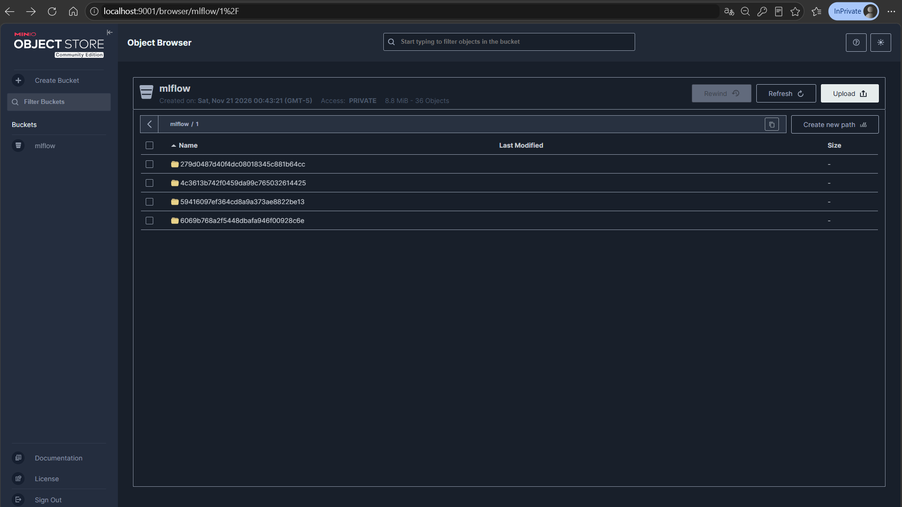
</p>

- **MinIO — Artefactos del modelo y explicabilidad:** binarios serializados del modelo ganador, gráficas de evaluación y archivos generados en `shap_analysis`.
<p align="center">
  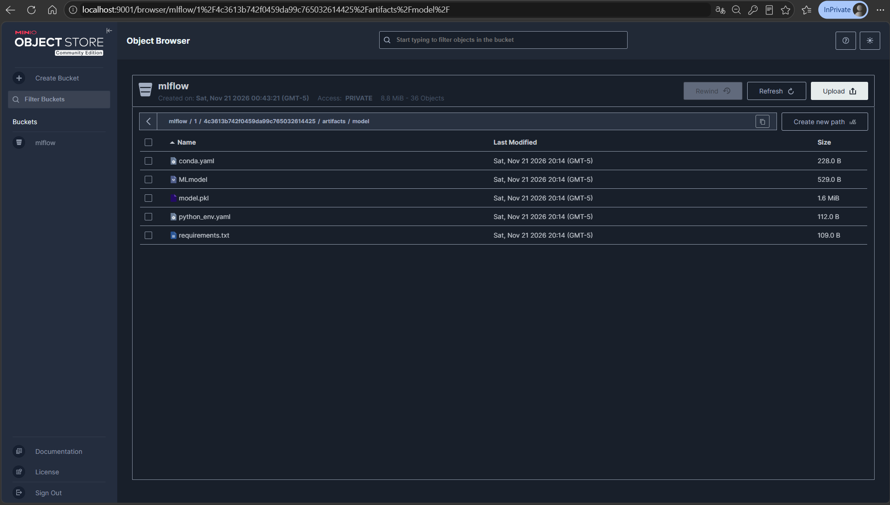
</p>

---

### 3. Inferencia y Capa de Usuario (FastAPI, Streamlit y SHAP)

- **FastAPI (`http://localhost:8000/docs`):** documentación interactiva Swagger con los endpoints `/health`, `/predict`, `/reload-model` y `/metrics`.
<p align="center">
  
</p>

- **Streamlit (`http://localhost:8501`) — Predicción en vivo:** formulario interactivo conectado a `POST /predict` de FastAPI para estimar precios inmobiliarios con el modelo `@champion` vigente.
<p align="center">
  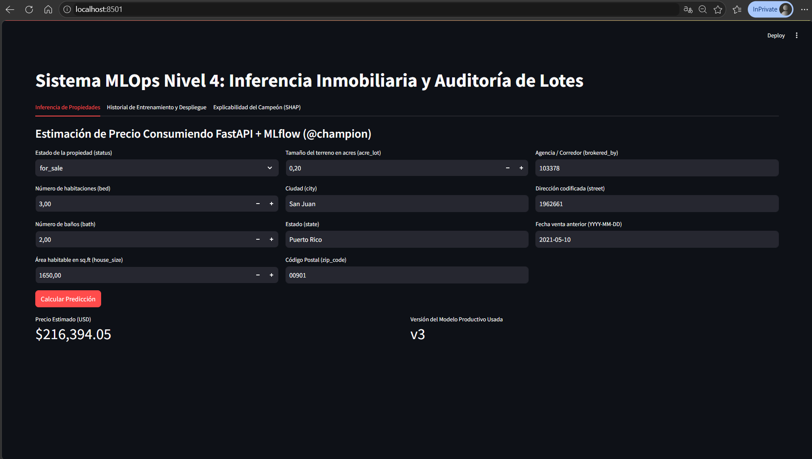
</p>

- **Streamlit — Historial y trazabilidad operativa:** consulta directa a PostgreSQL mostrando lotes procesados, auditoría de entrenamientos (`training_audit_log`) e historial de inferencias (`inference_logs`).
<p align="center">
  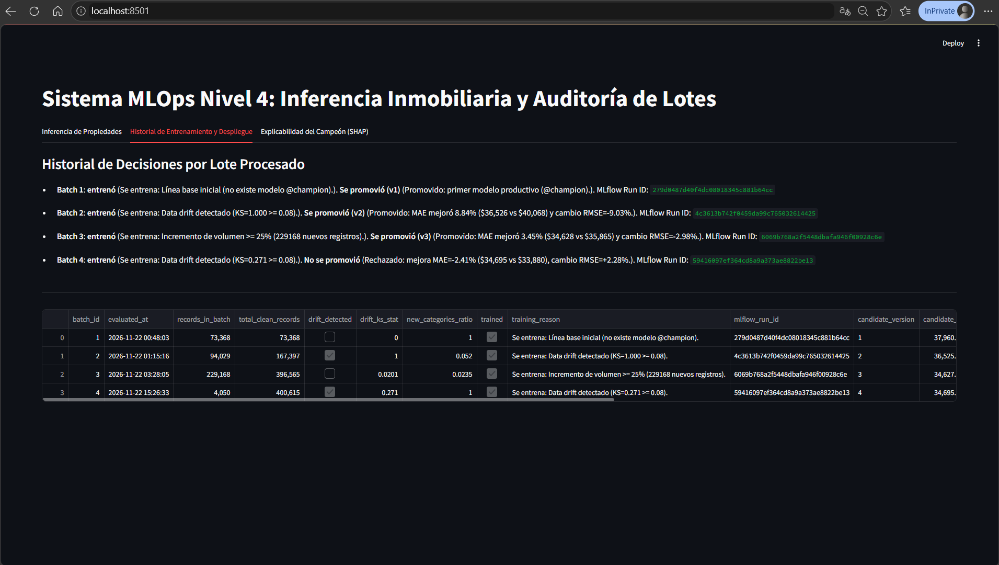
</p>

- **Streamlit — Explicabilidad del modelo `@champion` (SHAP):** visualización de importancia y contribución de variables generada por `shap_explainer.py` para la versión productiva activa.
<p align="center">
  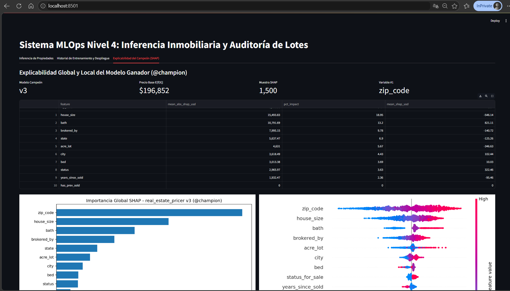
</p>

---

### 4. Observabilidad y Accesos Locales (Prometheus, Grafana y Localhost)

- **Prometheus (`http://localhost:9090`):** validación de *scraping* sobre `/metrics` de `fastapi-svc:8000` (target `UP`) y consultas PromQL de rendimiento.
<p align="center">
  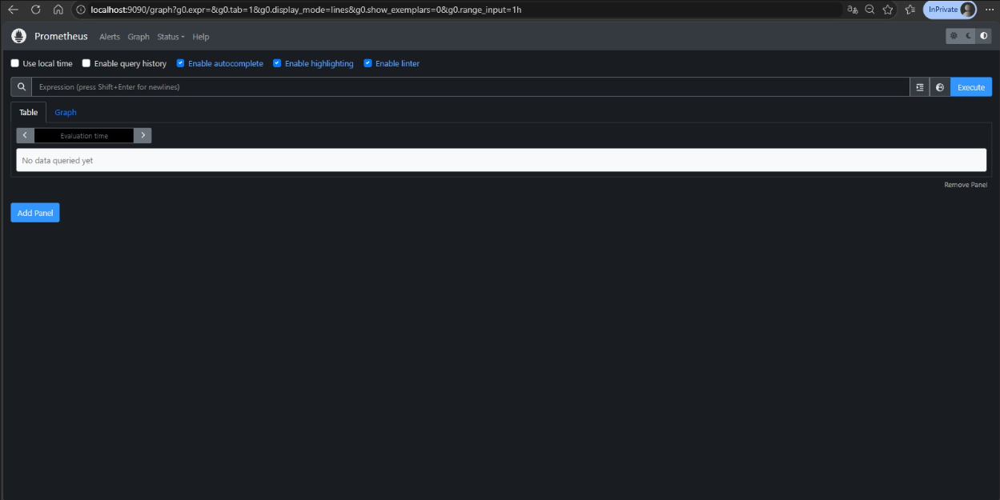
</p>

- **Grafana (`http://localhost:3000`):** dashboard `MLOps FastAPI & Locust Observability` monitoreando en tiempo real RPS, latencia P95, versión `@champion`, tasa de errores y consumo de CPU/RAM.
<p align="center">
  
</p>

- **Puertos locales (`start-ports.sh` / `localhost`):** verificación de los túneles `kubectl port-forward` activos sin colisiones para todos los servicios expuestos en `NBAM20`.
<p align="center">
  
</p>

---

## 10. Guía de Despliegue desde Cero en una Nueva Máquina

Esta guía permite levantar toda la plataforma en un servidor Linux limpio (probado en **Rocky Linux** y compatible con **Ubuntu/Debian**), partiendo desde la instalación de **K3s** hasta la validación completa.

### Prerrequisitos de la Máquina

- **Sistema operativo:** Linux 64-bit (Rocky Linux 8/9 o Ubuntu 22.04/24.04).
- **Recursos recomendados:** mínimo 4 vCPU, 12–16 GB de RAM y **30 GB o más de espacio libre en disco** (crítico para evitar alertas de `DiskPressure` en K3s).
- **Acceso a red:** salida a Internet y permisos `sudo`.

```bash
# En Rocky Linux / RHEL / CentOS
sudo dnf update -y
sudo dnf install -y git curl jq

# En Ubuntu / Debian
# sudo apt update && sudo apt install -y git curl jq
```

### Paso 1: Instalar y Configurar K3s

1. **Instalar K3s** (incluye `kubectl` y `crictl`):
   ```bash
   curl -sfL [https://get.k3s.io](https://get.k3s.io) | sh -
   ```
2. **Configurar `kubectl` para tu usuario:**
   ```bash
   mkdir -p ~/.kube
   sudo cp /etc/rancher/k3s/k3s.yaml ~/.kube/config
   sudo chown "$(id -u):$(id -g)" ~/.kube/config
   chmod 600 ~/.kube/config
   export KUBECONFIG=~/.kube/config
   echo 'export KUBECONFIG=~/.kube/config' >> ~/.bashrc
   ```
3. **Verificar que el nodo esté `Ready` y sin `DiskPressure`:**
   ```bash
   kubectl get nodes -o wide
   kubectl describe node | grep -i -A 5 Conditions
   ```

### Paso 2: Clonar el Repositorio

```bash
git clone [https://github.com/Joshin290/Proyecto_Final_MLOPS.git](https://github.com/Joshin290/Proyecto_Final_MLOPS.git)
cd Proyecto_Final_MLOPS
```

### Paso 3: Instalar y Configurar Argo CD (GitOps)

1. **Crear el namespace e instalar Argo CD:**
   ```bash
   kubectl create namespace argocd
   kubectl apply -n argocd -f [https://raw.githubusercontent.com/argoproj/argo-cd/stable/manifests/install.yaml](https://raw.githubusercontent.com/argoproj/argo-cd/stable/manifests/install.yaml)
   ```
2. **Esperar a que los pods de Argo CD estén listos:**
   ```bash
   kubectl wait --for=condition=Ready pods --all -n argocd --timeout=300s
   kubectl get pods -n argocd
   ```
3. *(Opcional)* **Obtener la contraseña inicial del usuario `admin`:**
   ```bash
   kubectl -n argocd get secret argocd-initial-admin-secret -o jsonpath="{.data.password}" | base64 -d; echo
   ```

### Paso 4: Crear el Namespace `mlops-pf` y Externalizar Secretos (`mlops-secrets`)

Las credenciales no están versionadas en GitHub y deben crearse manualmente en el clúster **antes** de sincronizar Argo CD:

```bash
kubectl create namespace mlops-pf

# Verificar las llaves exactas referenciadas en k8s/
grep -rn "mlops-secrets" k8s/ -A 4

# Crear el secreto con tus credenciales
kubectl create secret generic mlops-secrets -n mlops-pf \
  --from-literal=POSTGRES_USER=<usuario_postgres> \
  --from-literal=POSTGRES_PASSWORD=<password_postgres> \
  --from-literal=MINIO_ROOT_USER=<usuario_minio> \
  --from-literal=MINIO_ROOT_PASSWORD=<password_minio> \
  --from-literal=ADMIN_RELOAD_TOKEN=<token_recarga_fastapi>

kubectl get secrets -n mlops-pf
```

### Paso 5: Desplegar toda la Plataforma vía Argo CD

```bash
kubectl apply -f argocd-application.yaml
kubectl get applications -n argocd
kubectl get pods,svc,pvc -n mlops-pf -w
```

Espera a que todos los pods estén `Running` (`READY 1/1`), la aplicación figure como **`Synced` / `Healthy`** y confirma que `mlops-secrets` siga presente (`kubectl get secret mlops-secrets -n mlops-pf`). Luego continúa con la **Sección 9** para exponer puertos y validar el flujo end-to-end.

---

## 11. Proceso de Ejecución Paso a Paso

### Paso 1: Verificar el clúster y la sincronización GitOps

```bash
kubectl get pods -n mlops-pf
kubectl get deploy -n mlops-pf -o jsonpath='{range .items[*]}{.metadata.name}{"\t"}{.spec.template.spec.containers[0].image}{"\n"}{end}'
```

### Paso 2: Exponer los servicios localmente (`port-forward`)

Los servicios se comunican entre sí por el DNS interno de K3s sin necesidad de túneles. Para abrir las interfaces web desde tu navegador local, usa el script automatizado (recomendado) o los comandos manuales.

#### Opción A: Atajo automatizado con `start-ports.sh` (Recomendado)
Cierra túneles antiguos, detecta los nombres exactos de los servicios en `mlops-pf` y `argocd`, abre todos los *port-forwards* (incluyendo **Data API en `8002`** y **Argo CD en `8081`**) y valida cada puerto con `curl`:

```bash
chmod +x start-ports.sh
./start-ports.sh
```

Para detener todos los túneles limpiamente:

```bash
./start-ports.sh stop
```

*(Los logs individuales quedan en `/tmp/pf-*.log`.)*

#### Opción B: Ejecución manual

```bash
kubectl port-forward svc/airflow-svc    -n mlops-pf --address 0.0.0.0 8080:8080 > /tmp/pf-airflow.log    2>&1 &
kubectl port-forward svc/fastapi-svc    -n mlops-pf --address 0.0.0.0 8000:8000 > /tmp/pf-fastapi.log    2>&1 &
kubectl port-forward svc/data-api-svc   -n mlops-pf --address 0.0.0.0 8002:80   > /tmp/pf-data-api.log   2>&1 &
kubectl port-forward svc/mlflow-svc     -n mlops-pf --address 0.0.0.0 5000:5000 > /tmp/pf-mlflow.log     2>&1 &
kubectl port-forward svc/minio-svc      -n mlops-pf --address 0.0.0.0 9001:9001 > /tmp/pf-minio.log      2>&1 &
kubectl port-forward svc/streamlit-svc  -n mlops-pf --address 0.0.0.0 8501:8501 > /tmp/pf-streamlit.log  2>&1 &
kubectl port-forward svc/locust-svc     -n mlops-pf --address 0.0.0.0 8089:8089 > /tmp/pf-locust.log     2>&1 &
kubectl port-forward svc/prometheus-svc -n mlops-pf --address 0.0.0.0 9090:9090 > /tmp/pf-prometheus.log 2>&1 &
kubectl port-forward svc/grafana-svc    -n mlops-pf --address 0.0.0.0 3000:3000 > /tmp/pf-grafana.log    2>&1 &
kubectl port-forward svc/argocd-server  -n argocd   --address 0.0.0.0 8081:443  > /tmp/pf-argocd.log     2>&1 &
```

> **Nota:** Si algún servicio difiere en nombre dentro de tu clúster, verifica con `kubectl get svc -n mlops-pf` o usa `./start-ports.sh`, que resuelve los nombres automáticamente.

#### URLs de Acceso Local

| Servicio | URL Local | Uso Principal |
| :--- | :--- | :--- |
| **Airflow** | `http://localhost:8080` | Disparar y monitorear `real_estate_mlops_dag` |
| **FastAPI** | `http://localhost:8000/docs` | Endpoints `/predict`, `/health`, `/reload-model`, `/metrics` |
| **Data API** | `http://localhost:8002/docs` | Swagger de lotes incrementales (`group_number=3`, `day=Tuesday`) |
| **MLflow** | `http://localhost:5000` | Experimentos, métricas y alias `@champion` |
| **MinIO Console** | `http://localhost:9001` | Artefactos de modelos y explicabilidad SHAP |
| **Streamlit** | `http://localhost:8501` | Inferencia interactiva, historial y SHAP |
| **Locust** | `http://localhost:8089` | Pruebas de carga contra `http://fastapi-svc:8000` |
| **Prometheus** | `http://localhost:9090` | Targets (`UP`) y consultas PromQL |
| **Grafana** | `http://localhost:3000` | Dashboard `MLOps FastAPI & Locust Observability` |
| **Argo CD** | `https://localhost:8081` | Estado de sincronización GitOps (`Synced` / `Healthy`) |

### Paso 3: Ejecutar el pipeline de entrenamiento continuo en Airflow

1. Abre **Airflow** (`http://localhost:8080`) y dispara manualmente (*Trigger DAG*) **`real_estate_mlops_dag`**.
2. Observa en la vista *Graph* la ingesta (`group_number=3`, `day=Tuesday`), separación `RAW`/`CLEAN`, validación, *drift*, entrenamiento, registro en **MLflow** y decisión de promoción.
3. Verifica en **MLflow** (`http://localhost:5000`) el experimento `real_estate_continuous_training`, los artefactos en **MinIO** (`http://localhost:9001`) y el alias `@champion`.
4. Confirma la recarga en caliente en **FastAPI**:
   ```bash
   curl -s http://localhost:8000/health && echo ""
   ```

### Paso 4: Validar inferencia, historial y explicabilidad en Streamlit

1. Abre **Streamlit** (`http://localhost:8501`).
2. Realiza predicciones de prueba y revisa las pestañas de historial de lotes, decisiones de entrenamiento, logs de inferencia y explicabilidad **SHAP**.

### Paso 5: Ejecutar pruebas de carga con Locust y monitorear en Grafana / Prometheus

1. Abre **Locust** (`http://localhost:8089`), configura el **Host** como **`http://fastapi-svc:8000`** (DNS interno del clúster), define usuarios y *spawn rate* e inicia la prueba.
2. Verifica en **Prometheus** (`http://localhost:9090/targets`) que `fastapi-svc:8000` esté **`UP`** y valida `rate(inference_requests_total[1m])`.
3. Abre **Grafana** (`http://localhost:3000`) en **`MLOps FastAPI & Locust Observability`** y selecciona ventana **`Last 15 minutes`** (o **`Last 5 minutes`**) con refresco de **`5s`** para ver en vivo RPS, Latencia P95, `@champion`, tasa de errores y CPU/RAM.

---

## 12. Comandos Importantes y Referencia Operativa

### Estado del clúster, servicios e imágenes
```bash
# Ver pods, IPs y estado general
kubectl get pods -n mlops-pf -o wide

# Ver servicios y puertos expuestos
kubectl get svc -n mlops-pf

# Confirmar que las imágenes desplegadas coinciden con el último commit SHA
kubectl get deploy -n mlops-pf -o jsonpath='{range .items[*]}{.metadata.name}{"\t"}{.spec.template.spec.containers[0].image}{"\n"}{end}'
```

### Verificación de salud, métricas, logs y secretos
```bash
# Comprobar salud y versión @champion activa en FastAPI
curl -s http://localhost:8000/health && echo ""

# Verificar métricas Prometheus expuestas por FastAPI
curl -s http://localhost:8000/metrics | grep -E "^inference_requests_total|^loaded_model_version"

# Ver últimas peticiones recibidas por Data API (confirmar group_number=3 y day=Tuesday)
DATA_POD=$(kubectl get pods -n mlops-pf -o name | grep data-api | head -n 1)
kubectl logs -n mlops-pf "$DATA_POD" --tail=20

# Consultar credenciales activas de MinIO desde su pod
MINIO_POD=$(kubectl get pods -n mlops-pf -o name | grep -i minio | head -n 1)
kubectl exec -n mlops-pf "$MINIO_POD" -- env | grep -iE "MINIO_ROOT_USER|MINIO_ROOT_PASSWORD"

# Decodificar un Secret de Kubernetes
kubectl get secret mlops-secrets -n mlops-pf -o jsonpath='{.data}' | jq 'with_entries(.value |= @base64d)'
```

### Gestión de *port-forwards*
```bash
# Levantar / reiniciar todos los túneles de una vez
./start-ports.sh

# Detener todos los túneles activos
./start-ports.sh stop

# Verificar respuesta HTTP de los puertos locales manualmente
for p in 8000 8002 8080 8089 5000 9001 8501 3000 9090; do
  code=$(curl -s -o /dev/null -w "%{http_code}" --max-time 4 http://localhost:$p)
  echo "Puerto $p -> HTTP $code"
done
```

### Mantenimiento de disco en nodo K3s (`NBAM20`)
```bash
# Revisar espacio disponible en /var
df -h /var

# Podar imágenes y capas sin uso en containerd (seguro para pods en ejecución)
sudo /usr/local/bin/k3s crictl rmi --prune
```

### Consultas PromQL útiles (Prometheus)
```promql
# Peticiones por segundo (RPS)
rate(inference_requests_total[1m])

# Total acumulado de inferencias por estado y versión de modelo
inference_requests_total

# Versión numérica del modelo @champion cargado en memoria
loaded_model_version
```

### Credenciales y Acceso a Argo CD

* **URL local:** `https://localhost:8081` *(levantado automáticamente con `./start-ports.sh`)*
* **Usuario por defecto:** `admin`

```bash
# 1. Obtener la contraseña inicial del usuario admin (decodificada desde el Secret de Argo CD)
kubectl -n argocd get secret argocd-initial-admin-secret -o jsonpath="{.data.password}" | base64 -d; echo

# 2. Verificar que el secreto exista y que los pods de Argo CD estén en ejecución
kubectl get secret argocd-initial-admin-secret -n argocd
kubectl get pods -n argocd

# 3. Exponer únicamente la interfaz de Argo CD (si no estás usando ./start-ports.sh)
kubectl port-forward svc/argocd-server -n argocd --address 0.0.0.0 8081:443 > /tmp/pf-argocd.log 2>&1 &

# 4. Consultar el estado de sincronización GitOps desde terminal (Synced / Healthy)
kubectl get applications -n argocd
```

> **Nota:** Si al ingresar a `https://localhost:8081` el navegador muestra una advertencia de certificado autofirmado, acepta continuar al sitio local para abrir la consola web de Argo CD.

---

## 13. Retos Técnicos Encontrados y Soluciones (Troubleshooting)

| # | Reto / Incidente | Componente Afectado | Causa Raíz | Solución Aplicada |
| :---: | :--- | :--- | :--- | :--- |
| **1** | `OOMKilled` y `CrashLoopBackOff` durante el entrenamiento | Airflow (`real_estate_mlops_dag.py`) | `TargetEncoder` clasificó precios enteros como `multiclass` (matriz de 5–15 GiB) + 4 workers de Gunicorn por defecto (~1 GiB base). | Forzar `target_type="continuous"` en `TargetEncoder` y limitar `AIRFLOW__WEBSERVER__WORKERS=1`. |
| **2** | `DiskPressure` y `no space left on device` en `/var` | K3s / containerd (`NBAM20`) | Partición `/var` de 15 GB saturada por acumulación de imágenes antiguas etiquetadas con SHA. | Monitoreo con `df -h /var` y poda periódica con `sudo /usr/local/bin/k3s crictl rmi --prune`. |
| **3** | Conflictos de puertos usados y túneles `port-forward` colgados | Red local / K3s (`ClusterIP`) | Colisión de puertos locales (`8080` Airflow/Argo CD, `8000` FastAPI) y túneles huérfanos tras reinicios de pods. | Mapa fijo de puertos (`8081` Argo CD, `8002` Data API) y script automatizado `./start-ports.sh`. |
| **4** | Gráficas aparentemente estáticas en Grafana con Locust | Grafana / Locust / Prometheus | Ventana de Grafana en `Last 6 hours` comprimiendo picos recientes y necesidad de usar DNS interno en Locust. | Apuntar Locust a `http://fastapi-svc:8000`, validar target `UP` en Prometheus y ajustar Grafana a `Last 15 minutes` (`5s`). |
| **5** | Rechazo de `git push` y fallos en `git pull --rebase` | Git / GitHub Actions | Commits automáticos de `github-actions[bot]` en `main` + cambios locales sin confirmar. | Validar con `git diff`, restaurar cambios accidentales (`git restore`) y sincronizar con `git pull --rebase origin main`. |
| **6** | Protección de `mlops-secrets` en GitOps y permisos de MinIO | Argo CD / MinIO | `prune: true` requiere aislar secretos fuera de Git; PVC de MinIO requiere permisos de escritura al iniciar. | Externalizar `mlops-secrets` en `mlops-pf` y usar `initContainer` (`fix-minio-permissions`) en MinIO. |
| **7** | Consistencia de `/reload-model` al escalar réplicas | FastAPI | Un solo `POST /reload-model` detrás de un `Service` solo actualiza 1 pod si existen múltiples réplicas. | Mantener 1 réplica en la configuración actual y documentar propagación multi-réplica como mejora futura. |

---

### 13.1. `OOMKilled` y `CrashLoopBackOff` en Airflow (`TargetEncoder` + `AIRFLOW__WEBSERVER__WORKERS`)
- **Síntoma:** Al ejecutar `train_candidate_model`, el pod de Airflow terminaba con estado **`OOMKilled`** (incluso con límite de `4Gi`) entrando en **`CrashLoopBackOff`**.
- **Causa raíz:**
  1. **`TargetEncoder(smooth="auto")` en modo multiclase:** En `scikit-learn`, el parámetro por defecto `target_type="auto"` clasifica precios inmobiliarios sin decimales (ej. `250000.0`, `410000.0`) como `multiclass` en vez de `continuous`. Con miles de precios únicos y 3 columnas categóricas (`brokered_by`, `city`, `zip_code`), intentaba crear una matriz densa de `46.955 filas × (3 × precios_únicos) columnas`, disparando el uso de RAM a **5–15 GiB** en segundos.
  2. **Workers de Gunicorn sin límite:** Sin `AIRFLOW__WEBSERVER__WORKERS`, Airflow levanta 4 workers (~1 GiB base) dentro del mismo pod, y el scheduler reintentaba la tarea tras cada reinicio.
- **Solución aplicada:**
  1. Configurar explícitamente modo regresión en `services/airflow/dags/real_estate_mlops_dag.py`:
     ```python
     TargetEncoder(smooth="auto", target_type="continuous")
     ```
  2. Fijar `AIRFLOW__WEBSERVER__WORKERS=1` en `k8s/infrastructure/05-airflow.yaml`.

### 13.2. `DiskPressure` y error `no space left on device` en `/var` (`NBAM20`)
- **Síntoma:** Durante despliegues sucesivos (*rolling updates*), pods fueron desalojados (*Evicted*) por presión de `ephemeral-storage` (`DiskPressure=True`) o fallaban al extraer capas con `no space left on device`.
- **Causa raíz:** La partición `/var` de `NBAM20` cuenta con **15 GB** donde `containerd` guarda imágenes y *snapshots* de `overlayfs` (`/var/lib/rancher/k3s/...`). Las compilaciones etiquetadas con el SHA completo acumulaban capas antiguas hasta saturar el disco.
- **Solución aplicada:** Monitoreo preventivo con `df -h /var` (actuando al superar 75–80 %) y poda segura de imágenes no referenciadas mediante `sudo /usr/local/bin/k3s crictl rmi --prune`, sin afectar pods activos ni volúmenes persistentes de PostgreSQL/MinIO.

### 13.3. Conflictos de puertos usados y túneles `port-forward` colgados
- **Síntoma:** Colisión de puertos locales al exponer varios servicios a la vez y pantallas de carga infinita o `Connection refused` (puertos `5000`, `8080`, `8089`) tras sincronizaciones de Argo CD o reinicios de pods.
- **Causa raíz:** Aunque dentro de K3s cada servicio tiene su propia IP aislada (`ClusterIP`), en `localhost` los puertos no pueden repetirse y los túneles `kubectl port-forward` quedan huérfanos cuando se recrea un pod.
- **Solución aplicada:**
  1. Definir un mapa fijo sin colisiones (`8080` Airflow, `8081` Argo CD, `8000` FastAPI, `8002` Data API -> `80`, `5000` MLflow, `9001` MinIO, `8501` Streamlit, `8089` Locust, `9090` Prometheus y `3000` Grafana).
  2. Automatizar la gestión con **`./start-ports.sh`** (y `./start-ports.sh stop`), que limpia túneles colgados, detecta nombres de servicios y verifica cada puerto con `curl`.

### 13.4. Gráficas aparentemente estáticas en Grafana durante pruebas con Locust
- **Síntoma:** El dashboard `MLOps FastAPI & Locust Observability` parecía plano o sin movimiento mientras corría Locust.
- **Causa raíz:** Ventana temporal de Grafana en **`Last 6 hours`** comprimiendo picos recientes de 1–5 minutos, junto con la necesidad de apuntar Locust al DNS interno en lugar de `localhost`.
- **Solución aplicada:** Configurar el Host de Locust como `http://fastapi-svc:8000`, validar el target `UP` en Prometheus y cambiar Grafana a **`Last 15 minutes`** (o **`Last 5 minutes`**) con refresco de **`5s`**.

### 13.5. Conflictos de sincronización Git entre entorno local y `github-actions[bot]`
- **Síntoma:** Rechazo de `git push` por commits remotos adelantados o error `cannot pull with rebase: You have unstaged changes`.
- **Causa raíz:** GitHub Actions genera commits automáticos en `main` actualizando tags en `k8s/`, coincidiendo con cambios locales sin confirmar.
- **Solución aplicada:** Revisar siempre con `git status` y `git diff`, descartar modificaciones accidentales (`git restore <archivo>`), confirmar los archivos deseados y sincronizar con `git pull --rebase origin main` antes de `git push origin main`.

### 13.6. Protección de `mlops-secrets` en GitOps y permisos de MinIO
- **Síntoma / Reto:** Con `prune: true` y `selfHeal: true` en Argo CD, las credenciales debían permanecer fuera de Git sin ser eliminadas por el sincronizador, y MinIO necesitaba permisos de escritura sobre su PVC.
- **Solución aplicada:** Crear `mlops-secrets` manualmente en `mlops-pf` fuera del repositorio (con `CreateNamespace=true` en `argocd-application.yaml`) e incluir el `initContainer` `fix-minio-permissions` en el despliegue de MinIO.

### 13.7. Consideración de escalado horizontal de FastAPI con `/reload-model`
- **Observación técnica:** Con 1 réplica (1 worker), `POST http://fastapi-svc:8000/reload-model` actualiza el modelo `@champion` en memoria de inmediato. Si en el futuro se escala `fastapi` a múltiples réplicas detrás de `fastapi-svc` (o a múltiples workers de Uvicorn), un único `POST` sería enrutado por `kube-proxy` a un solo pod, provocando inconsistencia de versiones entre réplicas.
- **Mejora futura recomendada:** Propagar la actualización hacia todas las réplicas mediante *polling* ligero en segundo plano contra el alias `@champion` en MLflow, un bus Pub/Sub (Redis/NATS) o un `kubectl rollout restart deployment/fastapi` controlado.